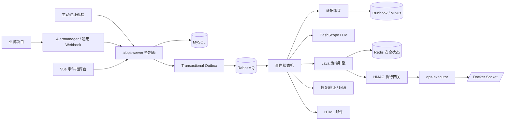

# AIOps 项目面试准备

> 项目定位：面向单机 Docker 工作负载的、证据驱动的全自动运维 Agent。
>
> 本文内容以当前仓库源码为准。文中的真实演示数据来自本地端到端测试，不应包装成生产环境数据。

## 面试时先说清楚这是什么项目

这个项目解决的场景是：业务项目已经运行在 Docker 中，当健康检查、Prometheus Alertmanager 或业务系统上报告警后，AIOps 平台自动接收事件，采集容器状态、日志、资源统计和 HTTP 健康信息，结合已审核 Runbook 与大模型生成结构化诊断，再经过确定性的安全策略判断是否允许修复。允许执行时，平台通过独立 Docker 执行器重启容器或使用稳定镜像重建，执行后重新检查健康状态；验证成功才把事件标记为 `RESOLVED`，失败则重试、回滚或进入 `MANUAL_REQUIRED`，并通过 HTML 邮件通知运维人员。

项目同时保留了一套交互式 AI 能力，包括 RAG 知识库问答、多轮会话、长期记忆、SSE 流式输出，以及基于 Spring AI Alibaba Graph 的 Planner、Executor、Replanner 多 Agent 告警分析。新版自动运维链路和旧版交互式 Agent 的职责不同，面试时要主动区分。

### 30 秒版本

我做的是一个基于 Spring Boot、Spring AI Alibaba、RabbitMQ、Redis、MySQL 和 Docker 的全自动运维 Agent。它可以接收其他项目或 Alertmanager 的告警，异步采集容器状态、日志、资源和健康检查证据，用 DashScope 大模型结合 Runbook 生成结构化诊断，再由 Java 策略引擎检查白名单、置信度、冷却时间、写入频率和熔断状态。通过策略后，系统调用隔离的 Docker 执行器完成重启或稳定镜像重建，并在健康验证通过后关闭事件，否则自动重试、回滚或发邮件通知人工接管。

### 2 分钟版本

原项目更接近 RAG 问答和告警分析 Demo，能生成报告，但生成报告不等于故障真的恢复。我把它改造成了事件驱动的 Docker 自动运维平台。

告警进入后，系统先在 MySQL 中做幂等落库，并在同一个事务里写 Outbox。后台发布器通过 RabbitMQ Publisher Confirm 确认消息已经被 Broker 接收，消费者再驱动事件状态机。状态机会依次完成证据采集、LLM 诊断、动作规划、策略校验、执行和恢复验证。大模型只负责输出动作建议、置信度、诊断摘要和验证建议，不能直接访问 Docker。

所有 Docker 权限都收敛到独立的 `ops-executor`。控制面请求执行器时使用 HMAC-SHA256 签名，并携带时间戳、Nonce 和稳定的请求 ID。执行器还会再次检查目标和动作白名单，通过持久化动作日志保证重复请求不会重复操作容器。Redis 用于服务级租约、冷却时间、每小时写入次数和熔断状态；Redis 不可用时，系统仍能接收和分析告警，但所有写操作会失败关闭。

我用一个可注入 503 故障的 Demo 服务做过完整测试。系统收集了容器状态、最近日志、资源统计和 HTTP 健康四类证据，真实调用通义千问后给出 `RESTART_CONTAINER`，置信度为 0.95。策略检查通过后容器被重启，健康检查恢复，事件进入 `RESOLVED`，同时邮件通知成功送达。

## 技术栈与模块划分

| 层次 | 技术 | 作用 |
| --- | --- | --- |
| 后端 | Java 17、Spring Boot 3.2 | API、领域逻辑、状态机和服务编排 |
| AI 接入 | Spring AI、Spring AI Alibaba、DashScope | 模型抽象、ChatClient、ReAct 与多 Agent 编排 |
| 消息 | RabbitMQ | 异步事件驱动、消费重试和死信处理 |
| 数据库 | MySQL、Flyway | 事件、时间线、动作、服务策略、Runbook 和 Outbox 的事实存储 |
| 安全状态 | Redis | 服务租约、写入计数、冷却时间和熔断 |
| 向量检索 | Milvus、etcd、MinIO | 文档向量和长期记忆的检索存储 |
| 容器执行 | Docker Java API | 查询容器证据、重启、重建、快照恢复 |
| 监控 | Prometheus、Grafana、Actuator | 指标采集、告警入口和运行观测 |
| 前端 | Vue 3、Vite | 本地事件指挥台、服务注册和处置审计 |
| 通知 | Spring Mail、SMTP | 人工介入和恢复成功的 HTML 邮件通知 |

Maven 工程被拆成四个后端模块：

- `aiops-server`：控制面，负责告警、AI 诊断、状态机、策略、消息、持久化、通知和对外 API。
- `ops-contract`：控制面与执行器共享的动作枚举、请求响应对象和 HMAC 签名协议。
- `ops-executor`：唯一能够访问 Docker Socket 的执行面，只执行固定动作。
- `demo-service`：支持故障注入的演示服务，用于验证自动恢复闭环。

`frontend` 是独立 Vue 3 工程，本地通过 Vite 启动，不依赖前端容器。自主运维中间件由 `docker-compose.autonomous.yml` 单独编排，端口也和旧容器隔离。

## 系统架构



这套架构分为三个边界：

**控制面**，决定事件接下来处于什么状态、需要什么证据、模型建议什么动作、策略是否允许执行。控制面不挂载 Docker Socket。

**执行面**，把固定的动作类型映射为 Docker Java API 调用。它不知道 Prompt、Runbook、RabbitMQ 和模型，只认签名请求、目标白名单和动作白名单。

**AI 边界**，模型接收事件、证据和已审核 Runbook，输出结构化建议。它不持有 Docker 权限，也不能绕过 Java 策略引擎。

## 一次故障从发生到恢复的完整链路

### 告警接入与去重

系统支持三种入口：

- `POST /api/v2/incidents`，任何语言的业务项目都可以通过通用 HTTP JSON 接入。
- `POST /api/v2/integrations/alertmanager`，直接接收 Prometheus Alertmanager Webhook。
- `ManagedServiceHealthMonitor`，周期调用已登记服务的健康地址，连续失败达到阈值后主动创建事件。

通用告警必须包含 `source`、`eventId`、`serviceId`、`severity` 和 `title`。数据库通过 `(source, event_key)` 唯一约束保证同一外部事件重复上报时只创建一次，代码还会根据服务和标题生成 SHA-256 指纹，便于后续做关联分析。

### 事务型 Outbox

接入服务在同一个 MySQL 事务中写入 `ops_incident`、首条时间线和 `ops_event_outbox`。这样可以避免以下不一致：

- 先写数据库再发 MQ，进程可能在两步之间崩溃，事件永远得不到处理。
- 先发 MQ 再写数据库，消费者可能先拿到消息，但数据库中还没有事件。

`OutboxPublisher` 每秒批量读取最多 50 条可发布记录，发送到 RabbitMQ，并等待 Publisher Confirm。Broker 确认后才把 Outbox 标记为已发布；失败则记录错误，后续轮询继续尝试。

### RabbitMQ 异步驱动

当前实现使用一个持久化 Direct Exchange、一个工作队列和一个死信队列。消费者并发数为 2，`prefetch=1`，Spring AMQP 监听容器在方法成功返回后确认消息。消费失败由监听器重试，最多 3 次，仍失败时因为 `default-requeue-rejected=false` 被路由到死信交换机。死信消费者把未终态事件转成 `MANUAL_REQUIRED` 并发送人工介入邮件。

RabbitMQ 的语义是 at-least-once，不追求理论上的 exactly-once。项目通过业务幂等让重复消息产生相同结果。

### 服务级租约

消费者开始处理事件时，先用 Redis `SET NX + TTL` 获取 `aiops:lock:service:{serviceId}` 租约，值是随机 Token。租约每分钟续期，释放时使用 Lua 脚本比较 Token 后再删除，避免旧线程误删新线程拿到的锁。

如果锁已被其他事件持有，当前事件延迟 10 秒重新入队。如果 Redis 故障导致安全状态不可用，流程可以继续收集证据和诊断，但写操作会被策略拒绝。

### 证据采集

`EvidenceCollector` 通过执行器调用四个只读动作：

- `GET_CONTAINER_STATE`：容器 ID、镜像、运行状态、启动时间和退出码。
- `GET_CONTAINER_LOGS`：默认读取最近 300 行，执行器硬限制在 20 到 1000 行。
- `GET_CONTAINER_STATS`：一次性读取 CPU、内存和网络统计。
- `CHECK_HTTP_HEALTH`：访问已登记的健康地址并记录状态码和响应体。

每类证据都有独立请求 ID。单项读取失败会转成失败证据，而不是让整包证据消失，诊断阶段可以看见证据缺口。

### Runbook 匹配与 LLM 诊断

自动运维链路先从 MySQL 中读取已启用 Runbook，用告警标题和证据文本匹配症状关键词。当前内置了容器崩溃和应用健康检查失败两类 Runbook。

匹配成功后，`IncidentDiagnosisEngine` 使用 Spring AI `ChatClient` 调用 DashScope 模型。系统提示要求模型只返回包含 `action`、`confidence`、`summary`、`rationale` 和 `verification` 的 JSON，并把动作限制在：

- `RESTART_CONTAINER`
- `RECREATE_WITH_STABLE_IMAGE`
- `MANUAL_REQUIRED`

模型调用失败、返回内容无法解析或 API Key 不可用时，系统回退到已审核 Runbook 的动作和最低置信度。没有匹配 Runbook 时不会让模型自由猜测，而是转人工处理。

这里要准确表达当前知识库能力。通用问答链路使用 Milvus 做向量 RAG；新版自动修复链路当前使用 MySQL Runbook 的关键词匹配，还没有把向量召回、重排和 Runbook 审批完整串入自动执行路径。

### 确定性策略校验

模型给出建议后，`AutomationPolicyEngine` 按固定顺序检查：

- 该服务是否启用自动化。
- 是否为受保护目标。
- 动作是否在服务白名单中。
- Redis 安全状态是否可用。
- 熔断器是否打开。
- 是否收集到了有效证据。
- 模型置信度是否达到服务阈值。
- 最近一小时写操作是否达到上限。
- 上次写操作后是否仍在冷却时间内。
- 稳定镜像重建是否具备稳定镜像和回滚快照。

模型输出具有概率性，策略判断是确定性的。任何一项不通过，事件都会记录具体拒绝码和原因并转人工，不会为了完成闭环而放宽规则。

### 隔离执行与双重白名单

控制面把动作封装成 `ActionRequest`，字段包括请求 ID、事件 ID、时间戳、Nonce、Key ID、动作、目标和参数。`HmacRequestSigner` 先对字段做确定性排序和长度编码，再使用 HMAC-SHA256 签名。

执行器收到请求后依次检查：

- 共享密钥至少 32 个字符。
- Key ID 是否一致。
- 请求时间与当前时间的偏差是否在允许窗口内。
- HMAC 是否正确，并用常量时间比较降低时序攻击风险。
- Nonce 是否已被使用，防止重放。
- 服务 ID 是否存在于 `executor-targets.yml`。
- 动作是否在该目标的执行器白名单中。

控制面的数据库白名单负责业务策略，执行器配置白名单负责能力边界。即使 Prompt 被注入或控制面数据库被错误修改，执行器也没有任意 Shell、宿主机命令、删除卷、清理镜像或操作未登记容器的接口。

### 动作幂等与未知结果

一次写动作使用 `incidentId + action + retryCount` 生成稳定幂等键。控制面在 `ops_action_execution` 中保存动作记录，执行器也会在本地 H2 日志中先写 `STARTED`，执行完成后保存完整结果。

重复请求有三种情况：

- 请求从未执行，写入 `STARTED` 后正常执行。
- 请求已经完成，直接返回之前保存的结果。
- 只找到 `STARTED`，但没有结果，说明执行器可能在 Docker 已改变后崩溃。系统把结果视为 `OUTCOME_UNKNOWN` 并转人工，而不是盲目重复写操作。

最后一种处理很重要。重启操作重复一次可能问题不大，但镜像重建、回滚等动作重复执行可能破坏现场。

### 自动修复、验证与回滚

当前写动作包括：

- `RESTART_CONTAINER`：调用 Docker Java API 重启白名单容器。
- `RECREATE_WITH_STABLE_IMAGE`：保存当前容器信息，把旧容器重命名为备份，用稳定镜像创建新容器。
- `RESTORE_SNAPSHOT`：新容器验证失败时删除替代容器，恢复并启动旧容器。
- `DISCARD_SNAPSHOT`：新容器验证成功后删除备份，但不删除数据卷。

动作成功不代表事件解决。`RemediationVerifier` 会重新查询容器状态和 HTTP 健康地址，只有容器运行且健康状态满足要求，状态机才允许进入 `RESOLVED`。普通重启验证失败时会带着新证据重试一次；稳定镜像重建失败时优先回滚，随后交给人工复核。

### 邮件通知

项目使用 Spring Mail 和 SMTP 发送两类通知：

- 自动修复验证成功，发送绿色恢复邮件。
- 策略拒绝、重试耗尽、未知执行结果或无法安全继续，发送橙色人工介入邮件。

邮件同时包含纯文本和 HTML 两种正文。HTML 模板突出服务、严重级别、事件 ID、来源、症状和处置信息，并对动态字段做 HTML 转义。发送失败会按配置重试，最终失败只写入事件时间线，不回滚已经完成的修复，也不把通知失败伪装成修复失败。

### 审计与前端

每次状态迁移、诊断、策略判断、动作、验证、回滚和通知失败都会写入时间线。Vue 事件指挥台每 5 秒刷新一次，可以查看：

- 处理中、已验证恢复和人工接管数量。
- 事件队列、严重级别和当前状态。
- Agent 诊断摘要、依据和置信度。
- 每一步处置时间线和动作记录。
- 托管服务、自动化开关、保护模式、置信度阈值、每小时写上限和冷却时间。
- 新服务注册表单。

## 项目里两套 Agent 能力

### 交互式多 Agent 告警分析

`AiOpsService` 使用 Spring AI Alibaba Graph：

- `SupervisorAgent` 负责在 Planner、Executor 和结束状态之间路由。
- `planner_agent` 同时承担 Planner 和 Replanner，根据任务与最近执行反馈生成下一步计划。
- `executor_agent` 每轮只执行计划中的第一步，调用工具收集证据，再把结构化反馈交还 Planner。
- Agent 可调用时间、内部文档、Prometheus 指标、日志、Runbook、风险矩阵、回滚计划和运维交接等工具。
- 达到结束条件后生成 Markdown 告警分析报告，通过 SSE 返回前端。

这套链路适合人工发起的开放式分析，因为排查路径会根据工具结果动态变化。

### 全自动故障处置 Agent

`AutonomousIncidentOrchestrator` 使用自研状态机，状态包括：

```text
RECEIVED
  -> COLLECTING_EVIDENCE
  -> DIAGNOSING
  -> PLANNED
  -> POLICY_CHECKING
  -> EXECUTING
  -> VERIFYING
  -> RESOLVED
```

异常分支包括 `RETRY_SCHEDULED`、`ROLLING_BACK`、`MANUAL_REQUIRED`、`FAILED` 和 `SUPPRESSED`。合法迁移集中定义在 `IncidentStateMachine` 中，JPA 乐观锁版本字段防止并发更新静默覆盖。

这套链路适合无人值守修复。流程路径由代码确定，模型只在 `DIAGNOSING` 节点提供建议，写操作由策略和执行器控制。

## 从零理解 Agent

### Agent 和普通聊天模型有什么区别

普通聊天模型的输入是 Prompt，输出是一段文本。Agent 在模型之外增加了状态、工具、循环和终止条件。一个最小 Agent 可以理解为：

```text
目标 + 当前状态 + 可用工具
          |
          v
      模型做决策
          |
     调工具 / 给答案
          |
       观察结果
          |
   更新状态并继续或结束
```

模型不会真的进入服务器执行命令。Tool Calling 的本质是模型返回“想调用哪个函数以及参数是什么”，应用程序负责校验参数、调用真实函数，再把结果返回模型。Spring AI 官方文档也强调，工具背后的 API 仍由应用控制，模型没有直接权限。

### Agent 常见组件

| 组件 | 含义 | 在本项目中的对应实现 |
| --- | --- | --- |
| Model | 负责理解、推理和生成决策 | DashScope 通义千问、Spring AI `ChatModel` |
| Prompt | 规定角色、输出格式和安全约束 | 诊断系统提示、Planner/Executor 提示 |
| State | 保存当前任务走到哪里 | `IncidentRecord`、`IncidentStatus`、时间线 |
| Memory | 保存近期对话和长期可召回信息 | MySQL 会话消息、摘要、Milvus 长期记忆 |
| Tools | 查询外部事实或执行动作 | 指标、日志、文档、Docker 只读与写动作 |
| Planner | 把目标拆成下一步 | 交互式 Agent 的 `planner_agent` |
| Executor | 执行步骤并返回观察 | `executor_agent` 或独立 `ops-executor` |
| Evaluator | 判断结果是否满足目标 | `RemediationVerifier` 和策略引擎 |
| Orchestrator | 决定节点顺序、重试和结束 | `SupervisorAgent` 或自研状态机 |

### ReAct 是什么

ReAct 是 Reasoning and Acting 的组合。模型根据当前目标进行推理，选择一个工具动作，观察工具结果，再继续推理。它适合排障，因为第一次只看到告警时通常无法直接确定根因，需要查询指标、日志、部署信息和文档。

在旧版交互式 Agent 中，`ReactAgent` 会动态选择工具。新版自动运维链路没有把完整 ReAct 循环交给模型，而是由 Java 固定完成“采集四类证据”，模型只做一次受约束诊断。这是为了降低延迟、费用和工具误调用风险。

### LangChain、LangGraph、Spring AI 和 Spring AI Alibaba Graph

| 框架 | 更接近什么 | 主要能力 |
| --- | --- | --- |
| LangChain | AI 应用组件库 | 模型、Prompt、Retriever、Tool、Agent 和链式调用 |
| LangGraph | 有状态图编排运行时 | 节点、边、共享状态、条件路由、持久化和长任务恢复 |
| Spring AI | Java AI 应用抽象层 | `ChatModel`、`ChatClient`、Tool Calling、RAG、向量数据库和可观测性 |
| Spring AI Alibaba Graph | Java 生态的图与多 Agent 编排 | `ReactAgent`、Supervisor、多 Agent、工作流、状态与流式执行 |

LangGraph 官方把 Workflow 定义为预先确定代码路径，把 Agent 定义为会动态决定流程和工具用法的系统。按这个标准，本项目新版自动处置是“LLM 增强的确定性 Workflow”，同时具备 Agent 的感知、诊断、行动和反馈闭环；旧版 `SupervisorAgent + ReactAgent` 更接近典型动态 Agent。

### 我们的 Agent 到底是不是 LangChain 或 LangGraph

面试时可以这样回答：

> 项目没有直接使用 Python 的 LangChain 或 LangGraph。交互式告警分析使用 Spring AI Alibaba Graph，它在 Java 生态中承担了和 LangGraph相近的状态图、多 Agent 编排和流式运行职责。全自动处置链路则是我用 Java 领域状态机自己实现的编排，Spring AI 只负责模型接入和结构化诊断。这样做是因为 Docker 写操作风险高，我希望每个状态迁移、重试、策略拒绝和回滚都由确定性代码控制，而不是由 LLM 自由决定。

这个回答不要缩成“我们用的是 LangGraph”。准确说法是“旧链路用了 Spring AI Alibaba Graph，新链路的设计思想类似有状态图工作流，但核心编排是自研状态机”。

### 新版 Agent 的伪代码

```java
while (!incident.isTerminal()) {
    switch (incident.status()) {
        case RECEIVED -> collectEvidence();
        case DIAGNOSING -> llmSuggestAction(evidence, approvedRunbook);
        case POLICY_CHECKING -> deterministicPolicyCheck();
        case EXECUTING -> signedExecutorCall();
        case VERIFYING -> verifyHealthOrRollback();
    }
}
```

这段代码体现了项目的核心思想：LLM 提供认知能力，Java 状态机掌握控制权，独立执行器持有最小化动作权限。

## RAG、知识库和记忆能力

项目原有问答链路支持文件上传、文档切分、向量化、Milvus 索引和 Top-K 检索。用户可以选择普通 Agent 模式或 RAG 模式，通过同步接口或 SSE 流式接口对话。

会话侧使用 MySQL 保存会话和消息，默认取最近 6 组消息作为短期上下文，并维护摘要。长期记忆被结构化后写入 Milvus，后续根据当前问题做向量召回。会话支持列表、读取、改名、清空和彻底删除，删除时可以同时清除 Milvus 中的记忆。

RAG 和自动运维 Runbook 不应混为一谈：

- RAG 问答允许从较大的非结构化文档库中召回文本，目标是帮助模型回答问题。
- 自动修复 Runbook 是已审核、动作受限的知识条目，目标是决定某类证据是否有资格进入自动执行策略。

未来可以用 Milvus 做 Runbook 候选召回和重排，但召回结果仍需要经过 `enabled`、版本、审批状态和动作白名单检查。

## 已完成的真实端到端演示

本地演示链路如下：

1. Demo 服务被注入不健康状态，健康接口返回 HTTP 503。
2. AIOps 接收事件并异步处理。
3. 执行器收集容器状态、最近日志、一次性资源统计和 HTTP 健康四类证据。
4. 匹配到“Application health check failure” Runbook。
5. 使用真实 DashScope API 调用通义千问，返回 `RESTART_CONTAINER`，置信度 0.95。
6. Java 策略检查证据、阈值、白名单、Redis 安全状态和写入边界。
7. HMAC 签名请求到达执行器，容器被重启。
8. 重启清除了 Demo 故障状态，健康检查恢复为成功。
9. 事件进入 `RESOLVED`，时间线和动作记录完整保留。
10. HTML 邮件通过 yeah.net SMTP 发送到 QQ 邮箱，用户确认收到。

面试时可以说“我做过一条真实模型调用和真实 Docker 重启的本地端到端测试”，不要说“已经在生产环境长期运行”。

## 项目相关高频面试题

### 1. 这个项目和普通告警平台有什么区别

普通告警平台主要完成检测、聚合和通知，修复依赖人工。这个项目继续完成证据采集、诊断、受控执行和结果验证。它不会在发出重启命令后直接关闭事件，只有健康验证通过才算恢复。

### 2. 为什么不让大模型直接调用 Docker 工具

模型输出会受 Prompt、日志内容和采样随机性影响。Docker Socket 权限接近宿主机高权限，一次错误调用可能影响其他容器或数据。项目把模型限制为“提出固定枚举动作”，Java 策略引擎负责审批，独立执行器再检查签名和白名单，形成模型、控制面和执行面的权限隔离。

### 3. 如何防止同一告警重复修复

项目用了多层幂等，但每一层解决的问题不同：入口通过 `(source,event_key)` 唯一索引去重；RabbitMQ 重复投递由状态机终态判断和 MySQL 动作幂等键吸收；同一服务并发事件由 Redis 租约串行化；执行器通过请求 ID 日志返回历史结果；Nonce 只用于防重放，不替代业务幂等。

### 4. 为什么需要事务型 Outbox

数据库事务和 RabbitMQ 发布不属于同一个本地事务，直接双写会出现只成功一边的情况。Outbox 把“待发送事件”作为业务事务的一部分保存，后台再可靠投递。它保证事件最终有机会发出，但仍可能重复发布，所以消费端必须幂等。

### 5. 为什么选择 RabbitMQ，不用 Kafka

这里传递的是需要尽快处理的故障命令，吞吐量不大，更关心逐条确认、低延迟、消费重试、死信和简单路由。RabbitMQ 与这个工作负载和已有学习经验更匹配。Kafka 更适合高吞吐、长时间保留、按 Offset 回放和多个独立消费组的日志或遥测流。如果未来要保存海量指标和原始事件流，可以让 Kafka 承担事件总线，但故障处置命令仍可保留 RabbitMQ。

### 6. Redis 挂了为什么不直接退化成本地锁

多实例部署时本地锁不能阻止其他实例同时操作同一容器。Redis 不可用时若继续写，会失去冷却、限次、熔断和互斥信息。项目选择 fail closed，只暂停写操作，仍允许告警接入、查询和诊断。运维系统宁可少做一次自动修复，也不能在失去安全状态时重复修改生产服务。

### 7. 状态机带来了什么价值

状态机把合法路径集中定义，防止某个 Service 随意把事件从 `RECEIVED` 改成 `RESOLVED`。每次迁移都会落时间线，进程重启后也能根据数据库状态继续判断。它还让重试、回滚和人工接管成为显式分支，方便测试和审计。

### 8. 为什么动作成功后还需要验证

Docker API 返回重启成功，只能说明命令被接受，不能说明应用已经恢复。应用可能启动后立即崩溃，也可能进程存在但依赖数据库不可用。项目同时看容器状态和业务健康端点，验证通过后才关闭事件。

### 9. 如何处理执行器调用超时，无法判断动作到底有没有执行

执行器会在改变 Docker 前持久化 `STARTED`，完成后保存结果。重试请求发现已有完成结果时直接返回；只发现 `STARTED` 时说明结果不确定。此时系统不重复操作，而是转 `MANUAL_REQUIRED`。这是把“至少一次消息”转换为“写动作至多执行一次或人工确认”的关键边界。

### 10. 重建容器如何回滚

执行器先停掉旧容器并重命名为带请求后缀的备份，再基于稳定镜像和原容器配置创建新容器。新容器验证失败时删除替代容器，把备份改回原名并启动；验证成功后才丢弃备份，而且不会删除卷。稳定镜像和快照缺一项时，策略不允许执行重建。

### 11. 其他项目怎么接入

接入有四步：业务项目提供能反映 Readiness 的健康端点；在 `executor-targets.yml` 配置目标容器、健康地址和执行器白名单；调用 `/api/v2/services` 注册控制面策略；由 Alertmanager 或业务代码向 `/api/v2/incidents` 发送带稳定 `eventId` 的告警。两层白名单都通过后才具备自动修复资格。

### 12. 如果大模型 API 调用失败怎么办

有匹配且已启用的 Runbook 时，使用 Runbook 推荐动作和最低置信度作为降级方案；没有 Runbook 时转人工。系统不会为了保持可用性而让无依据的模型建议进入执行阶段。

### 13. 如何防止日志中的 Prompt Injection

当前主要防线是权限隔离：日志只是诊断输入，模型输出只能选择固定动作，策略和执行器不会执行日志中的文本命令。完整生产方案还应在上下文中明确标记不可信证据、清理控制字符、限制日志长度、保留证据哈希，并对模型输出使用严格 JSON Schema 验证。

### 14. 项目里 MySQL 和 Redis 为什么同时存在

MySQL 保存不能丢的事实和审计数据，包括事件、状态、动作、Runbook、时间线和 Outbox。Redis 保存短生命周期的协调与安全状态，包括租约、冷却、计数和熔断。Redis 数据丢失不会改写历史事件，但会暂停新的写操作。

### 15. 项目最难的地方是什么

难点不在调用一次大模型，而在把概率性的建议接入确定性的故障处理系统。需要同时处理数据库与 MQ 一致性、重复消息、并发事件、执行结果未知、自动验证、回滚和权限隔离。我的设计原则是让 AI 负责理解和建议，让状态机、策略引擎和执行器负责控制与行动。

## Agent 与 RAG 延伸问题

### 1. Agent、Workflow 和 Chatbot 有什么区别

Chatbot 主要完成输入到文本输出；Workflow 的路径由代码预先规定；Agent 会根据状态和观察动态决定下一步工具。真实系统常常混合使用，低风险开放式分析用 Agent，高风险写操作用 Workflow。本项目正是这种混合架构。

### 2. Function Calling 和真实函数调用是什么关系

模型返回的是结构化调用意图，比如工具名和 JSON 参数。应用根据工具注册表找到函数，做权限与参数校验，执行后再把结果交还模型。模型本身没有网络、数据库或 Docker 权限。

### 3. Planner、Executor 和 Replanner 分别做什么

Planner 根据目标生成计划；Executor 一次执行一个步骤并返回观察；Replanner 根据新证据修改剩余计划。项目里 `planner_agent` 同时承担 Planner 和 Replanner，`executor_agent` 只执行第一步，`SupervisorAgent` 决定下一轮调用谁。

### 4. 为什么不能所有任务都用 Multi-Agent

Multi-Agent 会增加模型调用次数、上下文传递、延迟、费用和调试复杂度。只有任务能自然拆成不同角色，且角色之间确实需要动态协作时才值得使用。自动重启链路路径固定且风险高，因此用单次诊断加确定性状态机更合适。

### 5. RAG 如何降低幻觉，为什么不能消除幻觉

RAG 把与问题相关的外部文档放进上下文，让回答有事实依据，但检索可能召回错误内容，模型也可能误读或忽略证据。完整治理需要在检索侧优化分块、混合检索和重排，在生成侧约束“无证据不回答”，在结果侧做引用与事实校验，并持续回流 Bad Case。

### 6. 文档为什么要分块，Overlap 有什么作用

整篇文档通常超过模型和 Embedding 的有效输入长度，且大块文本会让向量语义过于平均。分块使每个向量代表相对聚焦的语义。Overlap 可以保留跨边界上下文，但过大会产生重复召回和存储浪费。当前项目配置支持最大块大小与重叠长度，生产中应通过真实问题集评估，而不是只凭经验设值。

### 7. 短期记忆、摘要和长期记忆怎么区分

短期记忆是最近几轮原始消息，信息完整但占 Token；摘要压缩更早的对话，降低上下文长度；长期记忆抽取可复用事实并向量化，按当前问题召回。三者都要带会话或用户边界，避免跨用户数据泄露。

### 8. 如何评估一个运维 Agent

可以分四层评估：诊断层看根因和证据引用是否正确；计划层看动作是否匹配 Runbook；安全层看不允许的动作是否全部被拦截；闭环层看修复后是否真正恢复、失败时是否回滚或转人工。还要记录模型延迟、Token、自动修复率、误修复率、平均恢复时间和人工接管率。当前项目完成了单场景端到端验证，还没有形成足够大的离线评测集。

## 与项目相关的八股问题

### 1. RabbitMQ Publisher Confirm 和 Consumer ACK 有什么区别

Publisher Confirm 解决生产者是否把消息可靠交给 Broker；Consumer ACK 解决消费者是否完成消息处理。二者相互独立。项目 Outbox 发布器等待 Publisher Confirm，消费端由 Spring AMQP 在监听方法成功后确认，异常则进入重试和死信流程。

### 2. at-least-once、at-most-once 和 exactly-once

at-most-once 可能丢消息但不重复；at-least-once 尽量不丢，但可能重复；端到端 exactly-once 在分布式系统中成本很高，通常依靠幂等把重复处理的业务结果做成一次。项目选择 at-least-once 加多层幂等。

### 3. Redis 分布式锁为什么要随机值和 Lua 删除

锁可能在业务执行期间过期并被另一个线程重新获得。旧线程如果直接 `DEL`，会删除新线程的锁。随机 Token 标识锁的持有者，Lua 把比较和删除放在一个原子操作中，只允许持有者释放。

### 4. 乐观锁和悲观锁有什么区别

悲观锁读取时就锁住数据，适合冲突高、事务短的场景；乐观锁通过版本号在更新时检查数据是否被别人修改，冲突后重试或失败。项目的事件实体包含 `version`，适合状态迁移这种冲突不频繁但不能静默覆盖的场景。

### 5. HMAC 是加密吗

HMAC 不是加密，它不隐藏请求内容，而是使用共享密钥计算消息认证码，用于验证完整性和发送方身份。项目再结合时间戳限制有效窗口、Nonce 防重放、HTTPS 或内网隔离保护传输机密性。

### 6. 为什么挂载 Docker Socket 风险很高

能访问 Docker API 的进程通常可以创建高权限容器、挂载宿主机目录或影响其他容器，权限接近宿主机管理员。项目只让独立执行器挂载 Socket，并且不提供通用代理接口。生产环境还应考虑 rootless Docker、Socket Proxy、mTLS、独立主机或远程受控执行器。

### 7. SSE 和 WebSocket 怎么选

SSE 基于 HTTP，服务端单向推送，自动重连和文本事件处理较简单，适合模型流式回答。WebSocket 是全双工，适合高频双向交互、在线协作和实时控制。项目聊天和报告输出只需要服务端持续推送，因此选择 SSE。

### 8. 什么是熔断、限流和降级

限流限制单位时间请求或动作数量；熔断在连续异常或风险状态下暂时拒绝调用；降级用较弱但安全的能力保持部分服务。项目的每小时写上限属于限流，服务自动化暂停属于熔断，模型失败后使用已审核 Runbook 属于降级。

## 当前项目的真实边界

面试中主动说明边界通常比声称“已经生产可用”更可信。

- 当前执行目标是单机 Docker，不支持 Kubernetes、跨主机调度和 SSH 运维。
- 自动处置 Runbook 使用关键词匹配，尚未接入混合检索、重排和版本审批工作流。
- 模型输出目前由 Prompt 约束后手动解析 JSON，后续应升级为 Provider Structured Output 加 JSON Schema 校验。
- 主动健康巡检的连续失败次数保存在进程内存，多实例或重启后会丢失，后续可迁移到 Redis。
- 邮件发送目前在工作流线程中同步重试，通知量大时应改成独立 Outbox 和通知队列。
- 执行器动作日志使用本地 H2，执行器高可用时需要共享且强一致的持久化存储。
- Docker Socket 即使以只读挂载方式传入，Docker API 仍可执行写操作，安全性依赖执行器代码和白名单；生产环境需要更强的主机隔离。
- 还没有完整的模型评测集、分布式追踪、集中日志、SLO 告警关联和长期压测数据。
- API Key、SMTP 授权码和执行器密钥在演示环境使用环境变量，生产环境应接入 Secret Manager，并为控制面到执行器增加 mTLS 和密钥轮换。

### 后续升级顺序

1. 建立故障样本集和 Agent 离线评测，统计诊断正确率、动作批准率、误修复率和恢复时间。
2. 把 Runbook 升级为版本化、可审批的混合检索，向量召回只负责找候选，确定性规则负责执行资格。
3. 为模型输出增加 Schema 校验、重试修复和 Prompt 版本记录。
4. 把健康失败计数、通知和验证调度迁移到可恢复的分布式状态。
5. 增加 OpenTelemetry Trace，把告警、模型调用、MQ 消息和执行器请求串成一条 Trace。
6. 完善执行器隔离、mTLS、RBAC、密钥管理和审计告警。
7. Docker 边界稳定后，再单独设计 Kubernetes Executor，不暴露任意 `kubectl` Shell。

## 面试回答中的注意事项

- 不要把一次本地演示说成生产环境效果，可以说“完成真实 API 和真实 Docker 操作的端到端验证”。
- 不要说模型自动执行命令，应说“模型提出动作建议，策略引擎审批，执行器执行固定动作”。
- 不要说用了 LangGraph，应明确区分 Spring AI Alibaba Graph 和自研状态机。
- 不要说自动运维链路已经用了 Milvus RAG，它当前依赖 MySQL Runbook 关键词匹配；Milvus 用在通用知识问答和长期记忆。
- 不要说 RabbitMQ 保证 exactly-once，应说 at-least-once 加业务幂等。
- 不要说 Docker Socket 的 `:ro` 就让 Docker API 只读，真正边界是独立执行器和动作白名单。
- 没有实测数据的问题不要编数字。可以给出指标设计，并说明下一步如何建立评测集。

## 面试前速记

```text
一句话：告警 -> 证据 -> LLM+Runbook -> 策略 -> 隔离执行 -> 验证 -> 回滚/通知

一致性：MySQL 事务型 Outbox + RabbitMQ Confirm + 消费幂等
并发安全：Redis 服务租约 + 冷却 + 写入限次 + 熔断，失败关闭
执行安全：HMAC + 时间戳 + Nonce + 双重白名单 + 固定动作枚举
结果安全：动作幂等日志 + 未知结果转人工 + 健康验证 + 快照回滚
Agent：旧版是 Spring AI Alibaba Graph 多 Agent，新版是自研状态机 + Spring AI 诊断
真实演示：503 -> 四类证据 -> Qwen 0.95 -> 重启 -> 健康恢复 -> RESOLVED -> 邮件
```

## LangChain、LangGraph、Spring AI 与 Spring AI Alibaba Graph 深度对比

### 先建立统一的心智模型

这四个名字不在同一个抽象层上，直接横向比较容易混乱。可以把一个 Agent 系统拆成五层：

```text
业务应用层：AIOps、客服、研究助手、代码助手
编排运行层：状态、节点、路由、循环、暂停、恢复
Agent 能力层：模型决策、工具调用、记忆、上下文和结构化输出
模型接入层：OpenAI、DashScope、Anthropic、Ollama 等供应商适配
基础设施层：数据库、向量库、消息队列、监控和部署
```

LangChain 和 Spring AI 主要覆盖模型接入与 Agent 能力。LangGraph 和 Spring AI Alibaba Graph 主要覆盖状态化编排。框架之间有交叉，但各自重点不同。

| 框架 | 主要语言 | 核心定位 | 抽象层次 | 最适合的任务 |
| --- | --- | --- | --- | --- |
| LangChain | Python、TypeScript | 模型、工具、Agent 和集成生态 | 高层 Agent 框架 | 快速构建工具型 Agent 和 AI 应用 |
| LangGraph | Python、TypeScript | 长任务、有状态图和持久化运行时 | 低层编排框架 | 复杂路由、暂停恢复、人工审批和多 Agent |
| Spring AI | Java | Spring 风格的模型、工具、RAG、记忆与 Advisor 抽象 | AI 应用基础框架 | 把 AI 能力接入现有 Spring Boot 系统 |
| Spring AI Alibaba Graph | Java | 图工作流、ReAct 和多 Agent 编排 | Agent 编排框架 | 在 Java 中实现类似 LangGraph 的状态工作流 |

截至 2026 年 8 月，LangChain v1 的 `create_agent` 底层会构建 LangGraph 图，所以 LangChain Agent 与 LangGraph 已经不是完全独立的两套运行机制。LangChain提供预制 Agent 和统一集成，LangGraph 提供更低层的状态图控制。Spring 生态也有类似分层，Spring AI 提供原子能力，Spring AI Alibaba Graph 在其上增加工作流和多 Agent。

### 共同的核心思想

#### 模型只是决策组件

四套框架都不会把 LLM 当成完整应用。模型负责理解输入、生成内容或提出工具调用，应用仍需要处理工具注册、状态保存、异常、权限和终止条件。

比如模型返回：

```json
{
  "name": "restart_container",
  "arguments": {
    "serviceId": "order-service"
  }
}
```

这只是调用意图。真正的函数查找、参数反序列化、权限判断和执行由框架及业务代码完成。本项目又增加了一层：即使模型提出 `RESTART_CONTAINER`，也必须通过 `AutomationPolicyEngine`，最后由独立执行器操作 Docker。

#### Tool 是模型与现实世界之间的接口

LangChain 使用 `@tool` 或 Tool 对象，Spring AI 使用 `@Tool`、`ToolCallback` 或 Java `Function`。工具都包含名称、描述、参数 Schema 和返回结果。模型根据描述选择工具，所以工具设计会直接影响 Agent 效果。

一个好的工具应满足：

- 名称表达单一动作，例如 `get_container_logs`。
- 描述说明适用条件，不只复述函数名。
- 参数少而明确，尽量使用枚举和结构化对象。
- 返回结果有稳定结构，错误和空结果可区分。
- 查询工具和写工具分开，写工具具有单独权限。

本项目的 `ActionType` 就是工具能力收敛后的枚举协议。它牺牲了任意命令的灵活性，换来了更容易审计和授权的执行边界。

#### Agent Loop 都是“模型、工具、观察、继续”

LangChain Agent、Spring AI `ToolCallingAdvisor` 和 Spring AI Alibaba `ReactAgent` 的基础循环一致：

```text
调用模型
  |
  | 模型返回工具调用
  v
应用执行工具
  |
  | 把工具结果追加到上下文
  v
再次调用模型
  |
  | 模型给出最终回答或达到停止条件
  v
结束
```

差别主要在谁控制循环。高层 Agent 框架自动控制；低层 API 允许业务代码自己控制。本项目旧版 `ReactAgent` 使用框架循环，新版自动处置由 `AutonomousIncidentOrchestrator` 自己控制流程。

#### 状态比聊天消息更宽

Agent State 不只是消息列表。它还可以包含任务目标、计划、工具结果、重试次数、审批结果、当前节点和业务对象。

LangGraph 常用一个 State 对象在节点间传递；Spring AI Alibaba Graph 使用 `OverAllState`；Spring AI 的基础 `ChatClient` 更偏向请求、响应和 Advisor Context；本项目使用 MySQL `IncidentRecord`、时间线、动作记录和 Redis 安全状态共同组成运行状态。

#### 确定性节点和概率性节点可以混合

Agent 系统不需要每一步都调用模型。分类、数据库写入、权限判断、格式校验和健康检查更适合普通代码。需要理解非结构化文本、关联证据或生成诊断时再调用 LLM。

LangGraph 与 Spring AI Alibaba Graph 都允许普通函数节点和模型节点混合。新版 AIOps 也采用同样思想：状态迁移、策略和执行是确定性代码，诊断节点使用模型。

#### 持久化让长任务可以恢复

内存中的 Agent Loop 进程一停就丢失。LangGraph 通过 Checkpoint 保存图状态，Spring AI Alibaba Graph 支持状态持久化和快照。本项目没有直接使用框架 Checkpoint，而是把事件状态、诊断、动作和时间线保存在 MySQL，通过 Outbox 重新调度。

三种方式目标相同，都是让任务在异常后继续，但持久化粒度不同：

| 方式 | 保存内容 | 恢复方式 |
| --- | --- | --- |
| LangGraph Checkpoint | 每个图步骤的 State 快照 | 从指定 Thread 和 Checkpoint 恢复 |
| Spring AI Alibaba Graph | `OverAllState` 与流程快照 | 从 Graph State 恢复执行 |
| 本项目 | 领域状态、动作记录、时间线和 Outbox | 根据事件状态重新进入编排器 |

本项目选择领域持久化，是因为事件状态本身需要给前端、审计和外部 API 使用，不希望只存在于 Agent 框架内部。

### LangChain 的设计思想

LangChain 的价值是统一常见 AI 组件和供应商差异。开发者可以用相似接口切换模型、定义工具、接入 Retriever、管理消息，并通过 `create_agent` 获得一个标准工具循环。

LangChain v1 可以分成几类能力：

- Model：统一不同模型供应商的消息和调用接口。
- Tool：把 Python 函数包装成模型可识别的工具。
- Agent：提供标准的模型与工具循环，底层运行在 LangGraph 上。
- Middleware：在模型调用和工具调用前后插入摘要、重试、人工审批、日志和安全检查。
- Retriever 与 Vector Store：实现 RAG 检索。
- LangSmith：提供 Trace、评测和调试平台，它不属于 LangChain 开源运行库本身。

LangChain 的优势是生态丰富、示例多、模型与工具集成广，适合快速验证。代价是 Python AI 生态更新快，抽象和 API 变动也更频繁。复杂业务流程如果全部塞进一个 Agent Loop，状态和异常分支会逐渐难以理解，此时通常需要下沉到 LangGraph。

### LangGraph 的设计思想

LangGraph 把 Agent 看成一个有状态图：

- Node 表示一步计算，可以是模型、工具或普通业务代码。
- Edge 表示固定迁移。
- Conditional Edge 根据 State 选择下一节点。
- State 保存节点之间共享的数据。
- Checkpointer 在每一步保存状态。
- Interrupt 允许流程暂停，等待人工输入后恢复。

一个运维图可以写成：

```text
START -> collect_evidence -> diagnose -> policy
                                      | allow
                                      v
                                  execute -> verify
                                      |           |
                                      | fail      | healthy
                                      v           v
                                  rollback       END
```

LangGraph 不替开发者决定 Prompt、工具和节点内部逻辑。它提供运行时和控制流，这也是它比高层 Agent 更适合复杂长任务的原因。

### Spring AI 的设计思想

Spring AI 不是 LangChain 的逐类 Java 翻译，它采用 Spring 应用熟悉的方式组织 AI 能力：

- `ChatModel` 统一模型供应商。
- `ChatClient` 提供类似 `RestClient` 的流式调用 API。
- `ToolCallback` 和 `@Tool` 暴露 Java 方法。
- `VectorStore` 统一向量数据库。
- `ChatMemory` 与 `ChatMemoryRepository` 管理模型需要的上下文。
- Advisor 在请求和响应链路中插入记忆、RAG、日志、工具循环和其他横切逻辑。
- Spring Boot Starter 和自动配置负责 Bean、配置属性和生命周期集成。
- Micrometer 和 Actuator 接入指标与 Trace。

Advisor 可以类比为专门面向 AI 调用链的拦截器。它能在模型调用前修改 Prompt、注入检索结果或记忆，也能在调用后检查结果。LangChain 中最接近它的是 Middleware，但两者 API 和生命周期并不相同。

当前 Spring AI 2.0 官方文档把 Tool Calling Loop 放进自动注册的 `ToolCallingAdvisor`。本项目固定使用 Spring AI 1.1.0，并且在自动诊断中通过 `ChatClient.create(chatModel)` 做单次结构化诊断，在交互式多 Agent 中由 Spring AI Alibaba Graph 管理循环。面试时不要把 2.0 的新 API 说成当前源码已经使用。

### Spring AI Alibaba Graph 的设计思想

Spring AI Alibaba Graph 官方文档明确说明其设计受 LangGraph 启发，可以在一定程度上理解为 Java 版 LangGraph。核心概念几乎可以一一对应：

| LangGraph | Spring AI Alibaba Graph | 含义 |
| --- | --- | --- |
| `StateGraph` | `StateGraph` | 定义整个图 |
| Node | Node | 一步模型调用或业务操作 |
| Edge | Edge | 节点之间的连接 |
| State | `OverAllState` | 流程共享状态 |
| Conditional Edge | Conditional Edge | 根据状态动态路由 |
| Checkpoint | State Persistence / Snapshot | 保存和恢复流程 |
| Prebuilt ReAct Agent | `ReactAgent` | 预制模型工具循环 |
| Supervisor Pattern | `SupervisorAgent` | 多 Agent 调度 |

它和 Spring AI 的关系类似 LangGraph 和 LangChain Core 的关系：Graph 负责编排，底层模型、消息和工具仍来自 Spring AI。项目里的 `AiOpsService` 正是用 `DashScopeChatModel`、`ReactAgent` 和 `SupervisorAgent` 组装交互式多 Agent。

### 四套框架逐项对比

#### 模型接入

LangChain 和 Spring AI 都通过统一接口屏蔽供应商差异。LangChain在 Python AI 生态中覆盖面更广；Spring AI 更容易复用 Spring Boot 的配置、依赖注入、HTTP 客户端、监控和配置中心。

共同边界是，统一接口只能覆盖公共能力。供应商特有的推理参数、缓存、多模态格式和结构化输出能力仍可能需要专用 Options。

#### 工具调用

LangChain Agent 和 Spring AI 都能自动执行 Tool Loop。LangChain 的 Tool 常由 Python 函数和 Pydantic Schema 构造；Spring AI 常由 Java 方法、注解、Jackson 类型和 Bean 构造。

Java 的静态类型让参数和返回对象更容易在编译期维护，Python 的动态类型让原型开发和工具拼装更快。无论哪种语言，破坏性工具都不能只依赖参数类型保证安全。

#### 编排

LangChain `create_agent` 和 `ReactAgent` 适合标准循环。LangGraph、Spring AI Alibaba Graph 和本项目自研状态机适合复杂分支。

选型可以看流程自由度：

| 流程特点 | 合适方案 |
| --- | --- |
| 一次模型调用或简单 RAG | Spring AI `ChatClient` 或 LangChain Model/Retriever |
| 模型自由选择多个只读工具 | LangChain Agent 或 Spring AI Tool Calling |
| 多步骤动态分析 | LangGraph 或 Spring AI Alibaba `ReactAgent` |
| 多角色协作 | LangGraph Subgraph 或 `SupervisorAgent` |
| 高风险固定写流程 | 领域状态机或严格 Graph Workflow |

#### 记忆

LangChain 和 LangGraph通常把当前消息放进 State，把跨会话事实放进 Store。Spring AI 区分 `ChatMemory` 和完整 `ChatHistory`，官方文档也建议完整历史使用 Spring Data 等单独保存。

本项目采用三层：最近消息窗口作为短期记忆，MySQL 摘要压缩更早对话，Milvus 保存可召回的长期记忆。运维事件则不使用聊天记忆，而是使用领域事件和时间线，因为它们需要精确审计。

#### RAG

LangChain 的 Retriever、Document、Text Splitter 与 Vector Store 生态成熟。Spring AI 使用 ETL、`VectorStore`、`QuestionAnswerAdvisor` 和 `RetrievalAugmentationAdvisor` 组织 RAG，更符合 Spring Bean 与 Advisor 的组合方式。

两边的底层链路一致：

```text
加载文档 -> 清洗 -> 分块 -> Embedding -> 向量存储
用户问题 -> 查询改写 -> 检索 -> 重排 -> 拼接上下文 -> 模型生成 -> 校验
```

框架能减少接入代码，不能自动保证检索质量。Chunk、Embedding、Top-K、过滤、重排和评测集仍需根据业务调整。

#### 扩展机制

LangChain v1 使用 Middleware，在模型和工具前后增加动态模型选择、摘要、重试、人工审批和安全检查。Spring AI 使用 Advisor Chain，在 Prompt 和响应调用链中增加记忆、RAG、Tool Calling 和可观测性。

两者共同采用横切逻辑与核心业务分离的思想。区别在于 Middleware 围绕 Agent State 和 Graph 运行，Advisor 更接近 `ChatClient` 请求响应链。业务级状态迁移仍应放在领域服务或图节点中，不能把整个事件状态机塞进 Advisor。

#### 持久化与恢复

LangGraph 的 Checkpoint 是通用图状态快照，适合暂停恢复和时间旅行调试。Spring AI Alibaba Graph 也支持状态持久化。本项目以 MySQL 领域模型和 Outbox 恢复，代码量更多，但事件数据可以直接被 API、Vue、审计和指标使用。

如果只是研究 Agent，框架 Checkpoint 更省事。如果状态本身就是核心业务对象，领域持久化更容易控制数据模型、事务和兼容性。

#### 可观测性

LangChain 生态通常配合 LangSmith 记录模型、工具、状态和评测。Spring AI 通过 Micrometer Observation、Actuator 和现有 Java 监控体系接入指标与 Trace。项目目前有 Actuator、Prometheus 指标、事件时间线和动作审计，但模型 Token、Prompt 版本和端到端 Trace 还需继续完善。

#### 部署和团队协作

Python 方案适合 AI 团队快速迭代模型、Prompt 和数据实验。Java 方案适合已有 Spring Boot 微服务、统一配置、鉴权、数据库和运维体系的团队。性能通常不是 Agent 选型的决定因素，模型网络延迟远大于普通框架调用开销。团队能力、现有系统、可靠性要求和维护成本更重要。

### 同一个工具 Agent 在四套方案中的样子

#### LangChain 高层 Agent

```python
agent = create_agent(
    model=model,
    tools=[get_logs, get_metrics],
    system_prompt="根据真实证据诊断故障"
)
result = agent.invoke({"messages": [user_message]})
```

框架生成标准模型与工具循环，适合快速开始。

#### LangGraph 自定义工作流

```python
graph = StateGraph(IncidentState)
graph.add_node("collect", collect_evidence)
graph.add_node("diagnose", diagnose_with_llm)
graph.add_node("policy", check_policy)
graph.add_node("execute", execute_action)
graph.add_conditional_edges("policy", route_by_decision)
workflow = graph.compile(checkpointer=checkpointer)
```

节点和路由由开发者控制，适合复杂状态和恢复。

#### Spring AI 基础调用

```java
String result = ChatClient.create(chatModel)
        .prompt()
        .system("根据真实证据诊断故障")
        .user(evidenceJson)
        .call()
        .content();
```

这和项目 `IncidentDiagnosisEngine` 的当前做法接近，只有一次受约束模型调用。

#### Spring AI Alibaba Graph

```java
ReactAgent planner = ReactAgent.builder()
        .name("planner_agent")
        .model(chatModel)
        .methodTools(metricsTools, logsTools)
        .build();

SupervisorAgent supervisor = SupervisorAgent.builder()
        .name("ai_ops_supervisor")
        .model(chatModel)
        .subAgents(List.of(planner, executor))
        .build();
```

这和项目旧版 `AiOpsService` 的实现接近，框架负责多 Agent 循环和共享状态。

### 为什么新版 AIOps 没有直接把全链路改成 Spring AI Alibaba Graph

框架能够表达这条状态图，但项目仍选择领域状态机，原因有四点：

1. 事件状态需要成为稳定的业务 API，并保存在 MySQL 中供审计和前端查询。
2. RabbitMQ、Outbox、动作幂等和回滚事务与现有 Spring 数据层结合紧密。
3. Docker 写操作风险高，所有合法迁移和失败分支需要由 Java 枚举与规则显式控制。
4. 项目要展示后端工程能力，而不只展示框架使用能力。

这不意味着 Graph 框架没有价值。可以把开放式证据调查做成一个 `ReactAgent` 子图，再把最终结构化诊断交给领域状态机。写操作、策略、验证和回滚仍保留在确定性工作流中。

### 如果分别用 LangGraph 和 Spring AI Alibaba Graph 重构

#### LangGraph 方案

Python Agent 服务负责证据分析和诊断，Java 控制面继续负责事件、策略和执行。优点是可以快速使用 LangChain 的 Retriever、Agent Middleware 和 LangSmith；缺点是增加跨语言服务、部署、协议和排障成本。

#### Spring AI Alibaba Graph 方案

在 `aiops-server` 内把 `COLLECTING_EVIDENCE -> DIAGNOSING -> PLANNED` 改为 Graph 子流程，继续复用 Spring Bean、Java DTO 和 DashScope。优点是技术栈统一；缺点是要处理 Graph State 与领域状态的双向映射，持久化边界也可能重复。

#### 当前混合方案

交互式分析使用 Graph，多轮路径由模型调整；自动处置使用领域状态机，模型只负责诊断。它的代码量高于全框架方案，但风险边界最清楚，也更符合当前单机 Docker 自动修复目标。

## 框架对比相关面试追问

### 1. Spring AI 是 Java 版 LangChain 吗

可以把两者放在同一类比较，因为都提供模型、Tool、RAG、记忆和统一供应商接口，但 Spring AI 不是逐类复制 LangChain。它使用 Spring Boot 自动配置、Bean、Advisor、Micrometer 和 Spring Data 形成自己的抽象。LangChain v1 更强调预制 Agent 与广泛的 Python AI 集成。

### 2. LangChain 和 LangGraph 是替代关系吗

不是。当前 LangChain v1 的 Agent 底层运行在 LangGraph 上。简单 Agent 直接使用 LangChain；需要自定义节点、条件路由、持久化和人工暂停时使用 LangGraph。也可以把一个 LangChain Agent 作为 LangGraph 的节点。

### 3. Spring AI 和 Spring AI Alibaba是什么关系

Spring AI 提供模型、消息、Tool、VectorStore、ChatMemory 等基础接口。Spring AI Alibaba 一方面提供 DashScope 等阿里生态适配，另一方面通过 Graph 和 Agent Framework 增加 ReAct、Supervisor 和工作流编排。本项目同时使用了两者。

### 4. Spring AI Alibaba Graph 和 LangGraph 有什么关系

官方文档说明其设计受 LangGraph 启发，可以理解为 Java 生态中的类似实现。两者都有 StateGraph、Node、Edge、共享状态、条件路由、持久化和多 Agent 模式，但 API、生态和运行时实现不同，不能说两者完全相同。

### 5. Advisor 和 Middleware 有什么共同点

它们都把日志、记忆、RAG、重试和安全检查这类横切能力从核心模型调用中拆出来。LangChain Middleware 工作在 Agent 与 LangGraph 生命周期中；Spring AI Advisor 工作在 `ChatClient` 调用链中。事件状态机这类领域流程不适合放进二者。

### 6. 什么情况下应该使用图编排

当任务有明确状态、多个分支、循环、人工审批、暂停恢复或长时间运行时，图编排比隐藏在 Prompt 中的流程更容易理解。一次问答或一次 RAG 没必要先建图，直接调用模型更简单。

### 7. 图编排是不是就不算 Agent

是否属于 Agent 取决于节点是否会根据环境和工具结果动态决策。完全固定路径是 Workflow；模型节点能选择工具或动态路由时具有 Agent 特征。生产系统经常把两者混合，没必要为了名称让所有节点都动态化。

### 8. 为什么 Java 项目不用 Python LangChain

当前控制面需要复用 Spring Boot、JPA、RabbitMQ、Redis、Actuator、配置管理和 Java 团队经验。把核心工作流留在 Java 可以减少跨服务调用和数据模型重复。Python 更适合模型实验和快速验证，如果未来需要复杂检索或模型评测，可以独立拆出 Python 服务，而不是为使用 LangChain 重写整个后端。

### 9. 框架能解决 Agent 幻觉吗

不能。框架提供 Tool、Schema、状态、重试和可观测性，能帮助建立护栏。幻觉治理仍依赖证据质量、Prompt、结构化输出、引用校验、权限策略和评测集。本项目最主要的防线是模型不直接执行写操作。

### 10. 框架的 Memory 等于数据库聊天记录吗

不等于。Memory 是当前模型推理需要的上下文子集，Chat History 是完整审计记录。把全部历史都放进 Prompt 会增加 Token 和噪声。项目把完整消息存 MySQL，再提取最近窗口、摘要和向量长期记忆供模型使用。

### 11. 使用框架后还需要消息队列和状态机吗

Agent 框架管理模型循环，不自动解决数据库与 MQ 双写、跨实例并发、动作幂等、业务审计和 Docker 回滚。RabbitMQ 和领域状态机属于分布式业务系统能力，不能由 `ReactAgent` 或 `create_agent` 替代。

### 12. 如何评价当前项目的框架选型

交互式分析使用 Spring AI Alibaba Graph，能展示 ReAct、Supervisor 和多 Agent；自动修复使用自研状态机，能展示事务、消息、幂等和安全边界。缺点是存在两套编排心智模型，需要在文档和代码中明确职责。后续可以把证据调查抽成 Graph 子流程，减少旧链路和新链路的功能重叠。

### 13. 如果面试官要求一句话说明四者关系

可以回答：

> LangChain 和 Spring AI 负责把模型、工具、记忆和 RAG 接进应用；LangGraph 和 Spring AI Alibaba Graph 负责把这些能力组织成长时间、有状态、可恢复的工作流。LangChain v1 的 Agent 底层使用 LangGraph，Spring AI Alibaba Graph 则是在 Spring AI 基础上提供类似 LangGraph 的 Java 编排能力。

### 14. 本项目最接近哪一种主流 Agent 架构

交互式链路是 Supervisor 调度的 Multi-Agent ReAct；自动修复链路是 LLM 增强的确定性状态工作流，也可称为受控 Agentic Workflow。面试时说明两条链路，比笼统说“这是一个 LangChain Agent”更准确。

## 更完整的学习顺序

对 Agent 基础接近零的情况，可以按下面顺序准备：

1. 理解一次 LLM 调用：System Message、User Message、Temperature、Token 和结构化输出。
2. 理解 Tool Calling：模型只生成调用意图，应用执行函数。
3. 理解 ReAct：模型、工具、观察的循环。
4. 理解 State：消息、计划、工具结果和业务状态如何保存。
5. 理解 Workflow：节点、边、条件路由、重试和终止。
6. 理解 Memory 与 RAG：一个保存交互上下文，一个检索外部知识。
7. 理解生产护栏：权限、幂等、超时、评测、Trace、人工介入和回滚。
8. 回到项目源码，把每个概念映射到具体类和数据表。

建议优先掌握 Tool Calling、ReAct、State 和 Workflow。Transformer 训练、RLHF 和模型微调可以了解基本概念，但这个项目的岗位价值主要在 AI 应用工程和 Java 后端，不需要把自己包装成模型算法工程师。

+
## Java 集合专项八股

本项目使用 Java 17。集合问题回答时，不要只背时间复杂度，要说明底层结构、操作过程、线程安全和项目中的选择。

### 先建立集合体系

| 接口 | 常见实现 | 核心特点 |
|---|---|---|
| List | ArrayList、LinkedList | 有序、允许重复、按下标或顺序访问 |
| Set | HashSet、TreeSet | 元素不重复 |
| Map | HashMap、LinkedHashMap、TreeMap | 键值映射 |
| Queue / Deque | ArrayDeque、LinkedList | 队列、双端队列 |
| 并发集合 | ConcurrentHashMap、CopyOnWriteArrayList | 支持多线程访问 |

Oracle 的 Java 17 集合文档将 ArrayList 归为可扩容数组，将 LinkedList 归为链表，将 HashMap 归为哈希表。通用实现默认不保证线程安全，迭代器通常采用 fail-fast 机制。参考：[Java 17 Collections Framework](https://docs.oracle.com/en/java/javase/17/docs/api/java.base/java/util/doc-files/coll-overview.html)。

### 1. ArrayList 的底层结构是什么

ArrayList 底层是 Object 数组。无参构造时不会立刻分配 10 个位置，第一次添加元素时才创建默认容量为 10 的数组。容量不足时通常扩容为原来的约 1.5 倍，再通过数组复制把旧数据移动到新数组。

查询 get(index) 可以直接计算数组偏移，时间复杂度为 O(1)。在尾部追加元素平均为 O(1)，但发生扩容时为 O(n)。在中间插入或删除时，需要移动后续元素，时间复杂度为 O(n)。

项目中，证据列表、搜索结果和时间线适合使用 ArrayList，因为主要操作是按顺序追加和遍历，很少在中间频繁插入。

### 2. ArrayList 和 LinkedList 怎么选

ArrayList 使用连续数组，随机访问快，内存局部性好；LinkedList 是双向链表，每个节点保存前驱、后继和元素引用。

常见回答：

- 频繁按下标查询，优先 ArrayList。
- 主要在尾部追加并遍历，通常仍优先 ArrayList。
- 已经拿到链表节点后，在该节点附近插入和删除才接近 O(1)。
- 如果先通过下标找到 LinkedList 中间节点，查找本身是 O(n)，所以“LinkedList 中间插入一定更快”并不准确。
- 实现队列或栈时通常优先 ArrayDeque，而不是 LinkedList，因为 ArrayDeque 对象开销更小、缓存局部性更好。

### 3. LinkedList 为什么既是 List 又是 Deque

LinkedList 是双向链表，既能通过 List 接口按顺序管理元素，也能通过 Deque 接口在头尾插入和删除。addFirst、addLast、removeFirst、removeLast 操作不需要整体移动元素。

它的缺点是每个节点都要额外保存两个引用，随机访问需要从头或尾遍历。在本项目的大部分证据和结果集合中，ArrayList 更合适。

### 4. HashMap 的底层结构是什么

Java 8 之后，HashMap 由“数组 + 链表 + 红黑树”组成。

put 的主要过程：

1. 计算 key 的 hash，并让高位参与低位运算。
2. 使用数组长度和 hash 计算桶下标。
3. 桶为空时直接插入。
4. 桶不为空时比较 hash 和 equals，key 相同就覆盖 value。
5. 发生冲突时放入链表；链表过长并且数组容量足够时转为红黑树。
6. 元素数量超过阈值时扩容。

get 也先定位桶，再在桶内比较 hash 和 equals。平均复杂度接近 O(1)，严重冲突的链表最坏为 O(n)，树化后为 O(log n)。

### 5. HashMap 为什么要求数组长度是 2 的幂

桶下标通过类似下面的方式计算：

~~~text
index = (length - 1) & hash
~~~

当 length 是 2 的幂时，length - 1 的二进制低位全部为 1，可以用位运算代替取模。扩容为两倍后，一个元素要么保持原位置，要么移动到“原位置 + 旧容量”，迁移判断也更简单。

### 6. HashMap 的负载因子为什么默认是 0.75

负载因子决定何时扩容：

~~~text
threshold = capacity × loadFactor
~~~

负载因子太小会频繁扩容并浪费空间，太大会增加哈希冲突。0.75 是时间和空间的经验折中，不代表所有场景都必须使用 0.75。

### 7. HashMap 什么时候树化

常见阈值是：

- 单个桶的链表长度达到 8。
- 数组容量至少为 64。

如果数组容量还不到 64，HashMap 通常优先扩容，而不是树化。树节点开销高，小容量下扩容往往比维护红黑树更划算。树中元素减少到一定程度时会退化为链表，常见退化阈值为 6。

### 8. hashCode 和 equals 有什么关系

如果两个对象 equals 为 true，它们的 hashCode 必须相同；hashCode 相同的对象不一定 equals。

HashMap 先比较 hash，再比较 equals。自定义对象作为 key 时，如果只重写 equals 不重写 hashCode，相等对象可能进入不同桶，导致查询失败。key 放入 HashMap 后也不应该修改参与 equals 和 hashCode 计算的字段。

### 9. HashMap 为什么线程不安全

多个线程同时 put、resize 或更新同一个桶时，可能发生数据覆盖、结构不一致和读取到中间状态。Java 8 虽然解决了早期扩容链表形成环的问题，但 HashMap 仍然不是线程安全容器。

多线程共享映射通常使用 ConcurrentHashMap。Java 8 之后它不再依赖固定 Segment 分段，读操作大多不加锁，写入时结合 CAS、volatile 和桶级 synchronized 控制并发。ConcurrentHashMap 不允许 null key 和 null value，避免并发场景下无法区分“没有映射”和“映射值为 null”。参考：[ConcurrentHashMap Java 17 API](https://docs.oracle.com/en/java/javase/17/docs/api/java.base/java/util/concurrent/ConcurrentHashMap.html)。

### 10. 什么是 fail-fast

ArrayList、HashMap 等集合维护结构修改计数 modCount。迭代器创建时保存 expectedModCount，遍历过程中发现两者不同，就抛出 ConcurrentModificationException。

它用于尽早暴露错误，不是线程安全保证，而且是 best-effort。单线程中一边 for-each 遍历一边直接删除元素也可能触发。需要删除时使用 Iterator.remove，或者使用 removeIf。

### 11. HashSet 怎么实现去重

HashSet 底层使用 HashMap。元素作为 key 存入 Map，value 使用同一个占位对象。是否重复由 hashCode 和 equals 共同判断。

### 12. 项目里 List、Map、Set 应该怎么解释

可以这样回答：

> 事故证据、向量检索结果和时间线需要保持顺序，使用 List；诊断详情和 Milvus metadata 是动态键值结构，使用 Map；需要保证工具名、字段名或关键词不重复时使用 Set。它们大部分是一次请求内的局部对象，没有跨线程共享，所以不需要一律替换成并发集合。真正的跨实例并发由数据库、Redis 租约和执行幂等控制。

---

## MySQL 专项八股

### 项目中 MySQL 存了什么

当前自主运维模块主要保存：

- managed_service，受管服务、容器名称、允许动作和安全阈值。
- ops_incident，告警原文、状态、诊断和版本。
- ops_action_execution，动作请求、结果、幂等键和回滚快照。
- ops_event_outbox，待发布到 RabbitMQ 的可靠事件。
- ops_runbook，结构化故障关键词、诊断提示、推荐动作和置信度要求。
- ops_incident_timeline，事故每个阶段的审计时间线。

autonomous Profile 关闭 Hibernate 自动建表，使用 Flyway 管理版本化 SQL。Compose 使用 MySQL 8.4，建表语句没有指定其他引擎，因此使用默认 InnoDB。

### 1. MySQL 有哪些常见存储引擎

常见引擎包括：

- InnoDB，MySQL 默认引擎，支持事务、行锁、MVCC、外键和崩溃恢复。
- MyISAM，不支持事务和行锁，主要是表锁，现代业务系统较少作为核心表引擎。
- Memory，数据主要位于内存，重启后数据丢失，适合非关键临时数据。
- Archive，适合大量追加和归档，查询能力有限。
- NDB，用于 MySQL Cluster 的分布式存储。

项目选择 InnoDB，因为事故入库、Outbox 和时间线必须在同一个事务中成功或失败，而且动作记录和事故记录存在关联。MySQL 8.4 官方也将 InnoDB 列为默认的 ACID 存储引擎。[MySQL 8.4 Storage Engines](https://dev.mysql.com/doc/refman/8.4/en/storage-engines.html)

### 2. InnoDB 和 MyISAM 的主要区别

| 对比 | InnoDB | MyISAM |
|---|---|---|
| 事务 | 支持 | 不支持 |
| 锁粒度 | 行锁为主 | 表锁 |
| MVCC | 支持 | 不支持 |
| 外键 | 支持 | 不支持 |
| 崩溃恢复 | 支持 | 能力较弱 |
| 聚簇索引 | 支持 | 数据和索引分离 |

本项目不能用 MyISAM 替代 InnoDB，因为 Transactional Outbox 依赖事务原子性。

### 3. 为什么 MySQL 索引常用 B+ 树

B+ 树具有以下特点：

- 非叶子节点只保存键和子节点指针，一个页能容纳更多索引项，树更矮。
- 数据集中在叶子节点，查询路径稳定。
- 叶子节点按顺序连接，适合范围查询和排序。
- 数据库一次磁盘或缓存页访问可以读取多个索引项。

哈希索引适合等值查询，但不适合范围查询、前缀匹配和排序。二叉树在数据量大时层数更高，磁盘访问次数更多。

### 4. 什么是聚簇索引和二级索引

InnoDB 聚簇索引的叶子节点保存整行数据，通常按主键组织。一个表只能有一个聚簇索引。

二级索引的叶子节点保存“二级索引列 + 主键值”。使用二级索引查询其他列时，先找到主键，再回到聚簇索引查整行，这个过程叫回表。

项目中的 ops_incident 主键 id 是聚簇索引；uk_ops_incident_source_event 是二级唯一索引。

### 5. 什么是覆盖索引

如果查询需要的字段全部包含在某个索引中，MySQL 可以只扫描索引，不再回表，这就是覆盖索引。EXPLAIN 的 Extra 中常见 Using index。

InnoDB 的二级索引会携带主键，所以查询二级索引列和主键时也可能形成覆盖索引。官方 EXPLAIN 文档说明了 key、key_len、rows、type 和 Using index 的含义。[MySQL EXPLAIN Output](https://dev.mysql.com/doc/refman/8.4/en/explain-output.html)

### 6. 什么是联合索引最左前缀原则

联合索引 (a, b, c) 按 a、b、c 的顺序排序。通常可以支持：

~~~text
a
a, b
a, b, c
~~~

直接只查 b 或 c 往往不能充分利用该索引。遇到范围条件后，后续列用于缩小扫描范围的能力通常会受影响，但 MySQL 还可能通过 Index Condition Pushdown 减少回表。

项目中的索引：

~~~sql
KEY idx_ops_outbox_poll (status, available_at, created_at)
~~~

对应查询先按 status 找 NEW 事件，再筛选 available_at 小于当前时间，最后按 created_at 取最早批次。列顺序与查询条件和排序方向一致。

### 7. 项目里有哪些重要索引

- UNIQUE(source, event_key)，防止同一来源和事件编号重复入库。
- INDEX(status, updated_at)，查找某种状态下长期未推进的事故。
- INDEX(fingerprint, created_at)，查询近期相似事故。
- UNIQUE(idempotency_key)，防止同一动作重复执行。
- INDEX(incident_id, created_at)，按时间读取动作和时间线。
- INDEX(status, available_at, created_at)，轮询可以发布的 Outbox 事件。
- UNIQUE(container_name)，避免多个服务配置指向同一容器。

回答时要说明索引服务于具体查询，索引不是越多越好。每个二级索引都会占空间，INSERT、UPDATE、DELETE 时也需要维护。

### 8. 哪些情况可能导致索引效果差

常见情况：

- 没有满足联合索引最左前缀。
- 对索引列做函数或计算，导致无法直接定位原值。
- LIKE 以百分号开头。
- 字符串列和数字参数发生隐式类型转换。
- OR 两侧没有合适索引。
- 查询返回大部分数据，优化器判断全表扫描更便宜。
- 索引区分度低，比如只有少量状态值。
- 统计信息不准确。
- 使用不等于、NOT IN 等条件时扫描范围很大。

不要背成“这些情况一定不走索引”。最终是否使用索引由优化器根据成本决定，应该用 EXPLAIN 或 EXPLAIN ANALYZE 验证。

### 9. 事务的 ACID 是什么

- Atomicity，原子性，一个事务中的操作全部成功或全部回滚，主要依赖 undo log。
- Consistency，一致性，事务前后满足业务和数据约束，是数据库能力与业务代码共同保证的结果。
- Isolation，隔离性，并发事务之间按隔离级别控制可见性和冲突。
- Durability，持久性，提交结果在故障后可以恢复，主要依赖 redo log 和持久化机制。

### 10. MySQL 有哪些事务隔离级别

- READ UNCOMMITTED，可能脏读。
- READ COMMITTED，每条语句使用新的已提交数据快照，避免脏读。
- REPEATABLE READ，同一事务的一致性读通常使用稳定快照，MySQL InnoDB 默认级别。
- SERIALIZABLE，隔离最强，并发能力最低。

InnoDB 提供四种标准隔离级别，默认是 REPEATABLE READ。[MySQL Transaction Isolation](https://dev.mysql.com/doc/refman/8.4/en/innodb-transaction-isolation-levels.html)

### 11. 脏读、不可重复读和幻读分别是什么

- 脏读，读到其他事务尚未提交的数据。
- 不可重复读，同一事务两次读取同一行，值发生变化。
- 幻读，同一事务两次按范围查询，结果行数发生变化。

InnoDB 的普通快照读通过 MVCC 解决大部分读一致性问题；当前读和范围更新还会涉及记录锁、间隙锁和 Next-Key Lock。

### 12. MVCC 是什么

MVCC 是多版本并发控制。数据更新时不会只保留一个版本，旧版本可以通过 undo log 和事务信息重建。普通 SELECT 根据 Read View 判断哪个版本对当前事务可见，因此读操作通常不需要阻塞写操作。

简化理解：

~~~text
当前行版本不应该被我看到
→ 根据回滚指针查找更早版本
→ 直到找到对当前 Read View 可见的版本
~~~

READ COMMITTED 通常每条一致性读创建新快照，REPEATABLE READ 通常在事务第一次一致性读时建立快照并复用。

### 13. undo log、redo log 和 binlog 有什么区别

- undo log 保存修改前的信息，用于事务回滚和 MVCC。
- redo log 记录 InnoDB 页修改，用于崩溃恢复和持久性。
- binlog 是 MySQL Server 层的逻辑日志，用于复制、审计和时间点恢复。

undo 解决“撤销和旧版本”，redo 解决“已提交数据如何抗崩溃”，binlog 解决“复制和逻辑恢复”。MySQL 官方说明 undo 记录可以帮助恢复聚簇索引记录的旧值。[MySQL Undo Logs](https://dev.mysql.com/doc/refman/8.4/en/innodb-undo-logs.html)

### 14. 项目的 Transactional Outbox 为什么需要事务

IncidentIngestionService 在同一个数据库事务中：

1. 插入事故。
2. 插入事故时间线。
3. 插入 Outbox 事件。

如果任一步失败，事务回滚。事务成功后，OutboxPublisher 再把事件发送到 RabbitMQ。

它解决的问题是：

~~~text
事故保存成功
→ 应用在发送 RabbitMQ 前宕机
→ 没有 Outbox 时任务永久丢失
~~~

有 Outbox 后，待发送事件已经在数据库中，定时发布器可以重试。它通常提供 at-least-once，而不是天然 exactly-once，所以消费者和执行器仍要幂等。

### 15. 如何分析一条慢 SQL

推荐按这个顺序回答：

1. 从接口耗时、应用日志和数据库监控确认慢点在 SQL，而不是网络或连接池。
2. 获取真实 SQL 和参数，检查慢查询日志或 Performance Schema。
3. 使用 EXPLAIN 查看 type、possible_keys、key、key_len、rows、filtered 和 Extra。
4. MySQL 8 可以在安全环境使用 EXPLAIN ANALYZE 对比估算行数与实际行数。
5. 检查 WHERE、JOIN、ORDER BY、GROUP BY 是否有合适索引。
6. 检查返回字段和行数，避免无必要的 SELECT * 和大分页。
7. 检查锁等待、长事务、连接池和磁盘 IO。
8. 优化后用相同数据量和参数重新测量，不能只看“走了索引”。

EXPLAIN 中 type 为 ALL 通常表示全表扫描，key 为 NULL 表示没有选择索引，但小表全表扫描不一定有问题。

### 16. 如何分析 MySQL 报错或线上异常

先按错误类型分类：

- 连接问题，检查连接池耗尽、最大连接数、网络、DNS 和账号权限。
- SQL 语法或约束问题，检查错误码、唯一键、外键和字段类型。
- 慢查询，使用慢日志、EXPLAIN ANALYZE 和监控。
- 锁等待，查看事务和锁等待关系。
- 死锁，执行 SHOW ENGINE INNODB STATUS 查看最近一次死锁。
- 磁盘或日志问题，检查磁盘空间、redo、binlog 和错误日志。

不要一上来重启数据库。先保存错误时间、SQL、参数、事务 ID 和当时的监控，否则重启可能清除关键现场。

### 17. 什么是死锁，怎么处理

死锁是多个事务各自持有对方需要的锁，形成循环等待。InnoDB 默认会检测死锁，并回滚其中一个事务。应用仍然要捕获死锁异常并对可重试事务进行有限次数重试。

减少死锁的方法：

- 多个事务按相同顺序访问表和行。
- 缩短事务，避免事务中执行远程调用。
- 为更新条件建立合适索引，减少锁定范围。
- 一次更新更少的数据。
- 查看 SHOW ENGINE INNODB STATUS 分析锁顺序。

MySQL 官方也建议保持事务短小、统一更新顺序并为锁定条件建立索引。[InnoDB Deadlocks](https://dev.mysql.com/doc/refman/8.4/en/innodb-deadlocks.html)

### 18. 项目如何实现告警幂等

数据库使用 UNIQUE(source, event_key) 保证唯一性，应用先查询已有事件，再通过 INSERT IGNORE 处理并发插入竞争。

只在 Java 中“先查再插”不够，因为两个实例可能同时查不到。最终需要数据库唯一约束兜底。fingerprint 用于标识相似事故，不是当前入库幂等的唯一依据。

---

## Redis 专项八股

### 项目中 Redis 的用途

本项目没有把 Redis 主要当成业务数据缓存，而是作为自动运维的短期安全状态存储：

- aiops:lease:{serviceId}，服务级租约，避免两个事故同时修改同一服务。
- aiops:writes:{serviceId}，时间窗口内的写操作次数。
- aiops:last-write:{serviceId}，最近一次写操作时间。
- aiops:circuit:{serviceId}，服务熔断状态。

这些键主要使用 String 和 TTL。Compose 明确启用了 AOF，并挂载独立数据卷。

### 1. Redis 常见数据类型及底层结构

以项目使用的 Redis 8.2 和常见实现为背景，可以这样回答：

| 数据类型 | 常见内部结构 | 场景 |
|---|---|---|
| String | SDS，整数值可使用整数编码 | 缓存、计数器、分布式锁 |
| List | quicklist，节点中使用 listpack | 队列、时间线 |
| Hash | listpack 或 hashtable | 对象字段 |
| Set | intset、listpack 或 hashtable | 去重、集合运算 |
| ZSet | listpack，或 skiplist + dict | 排行榜、延迟任务 |
| Stream | radix tree + listpack | 消息流和消费组 |
| Bitmap | 基于 String 的位操作 | 签到、状态位 |
| HyperLogLog | 概率结构 | 近似去重计数 |

内部编码会随元素数量、元素大小和 Redis 版本变化，可以通过 OBJECT ENCODING 检查。Redis 官方数据类型文档列出了 String、Hash、List、Set、Sorted Set 和 Stream 等类型及其用途。[Redis Data Types](https://redis.io/docs/latest/develop/data-types/)

### 2. SDS 相比 C 字符串有什么优势

SDS 保存长度和容量，不需要每次通过结束符扫描长度；支持二进制安全；扩容时可以减少频繁内存分配；操作前会检查空间，降低缓冲区溢出风险。

Redis String 可以保存文本、序列化数据、图片字节和整数，不只是字符字符串。

### 3. ZSet 为什么同时需要跳表和字典

字典便于按 member 快速查询 score，平均复杂度接近 O(1)；跳表按 score 维护顺序，适合范围查询和排名，操作复杂度通常为 O(log n)。

小数据量时可能使用更紧凑的 listpack，减少内存开销。

### 4. Redis 为什么快

主要原因：

1. 数据主要在内存中，避免普通磁盘随机访问。
2. String、Hash、List、Set、ZSet 等结构针对场景优化。
3. 核心命令执行大多是单线程顺序处理，减少锁竞争和线程切换。
4. 使用 IO 多路复用，一个线程可以管理大量连接。
5. 协议简单，并支持 Pipeline 批量发送请求。
6. 持久化、释放内存和部分网络 IO 可以由后台线程或子进程处理。

“Redis 完全是单线程”不准确。核心命令执行长期以单线程模型为主，Redis 6 之后可使用多线程处理网络读写，持久化等工作本来也会使用后台线程或子进程。

### 5. Redis 有哪些持久化方式

- RDB，在某个时间点生成数据快照。文件紧凑、恢复快，但两次快照之间的数据可能丢失。
- AOF，记录写命令，重启时重放。数据更完整，但文件通常更大，需要重写。
- RDB + AOF，同时使用两种方式，兼顾备份和较小的数据丢失窗口。
- 不持久化，适合允许全部丢失的纯缓存。

AOF 常见 fsync 策略：

- always，每次写都同步磁盘，可靠性高、性能较低。
- everysec，每秒同步，性能和可靠性折中。
- no，交给操作系统决定同步时机。

Redis 官方持久化文档说明，Redis 7 之后使用多段 AOF，由基础文件、增量文件和 manifest 组成。[Redis Persistence](https://redis.io/docs/latest/operate/oss_and_stack/management/persistence/)

### 6. 项目选择了哪种持久化

docker-compose.autonomous.yml 中使用：

~~~text
redis-server --appendonly yes
~~~

因此明确启用了 AOF。项目中的租约本身依赖 TTL，即使恢复出旧租约也会过期；写次数和熔断状态恢复后可以继续保护服务。MySQL 仍是事故和执行记录的最终持久化来源，Redis 不是系统事实的唯一来源。

### 7. 缓存穿透是什么，怎么解决

缓存穿透是请求的数据在缓存和数据库中都不存在，请求每次都落到数据库。

解决方式：

- 参数和权限校验，拦截明显非法请求。
- 对空结果设置较短 TTL。
- 使用 Bloom Filter 先判断 key 是否可能存在。
- 限流和风控，防止恶意随机 key。

缓存空值时要控制 TTL，否则大量无效 key 会占内存；Bloom Filter 有误判，但不会把一个确定存在的元素判断为不存在。

### 8. 缓存击穿是什么，怎么解决

缓存击穿通常指一个热点 key 失效，大量并发请求同时访问数据库。

解决方式：

- 使用互斥锁，只允许一个请求重建缓存。
- 使用逻辑过期，旧值先返回，由后台线程更新。
- 热点数据不过期，通过更新流程主动刷新。
- 提前刷新并增加降级方案。

互斥锁必须有超时，并考虑持锁线程失败后的恢复。

### 9. 缓存雪崩是什么，怎么解决

缓存雪崩是大量 key 同时过期，或整个 Redis 服务不可用，导致请求集中冲击数据库。

解决方式：

- TTL 增加随机值，避免同一时间过期。
- 热点数据分批预热。
- 使用本地缓存加 Redis 的多级缓存。
- Redis 主从、哨兵或集群提高可用性。
- 接口限流、熔断和降级。
- 数据库侧做好容量保护。

穿透是“查不存在的数据”，击穿是“单个热点 key 失效”，雪崩是“大量 key 或整个缓存同时失效”。

### 10. Redis 分布式锁怎么实现

单实例常见正确做法：

~~~text
SET lockKey randomToken NX PX 30000
~~~

- NX 保证不存在时才设置。
- PX 设置租约时间，防止持有者宕机后永远不释放。
- randomToken 标识锁的所有者。

释放时不能先 GET 再 DEL，因为两条命令之间可能发生锁过期和其他客户端重新加锁。应该使用 Lua 原子比较 token 并删除。续期同样先比较 token，再更新 TTL。Redis 官方分布式锁文档给出了 SET NX PX 和唯一随机值方案。[Redis Distributed Locks](https://redis.io/docs/latest/develop/clients/patterns/distributed-locks/)

### 11. 项目的租约是怎么实现的

RedisSafetyStateStore 使用 setIfAbsent(key, token, ttl) 获取租约，效果对应 SET NX PX。释放和续期使用 Lua：

~~~text
如果 Redis 中的 token 仍等于我的 token
→ 删除或续期
否则
→ 不操作
~~~

Orchestrator 每分钟续期，执行生产写动作前再次检查租约。如果 Redis 不可用或租约失效，系统不继续执行写操作，而是安全失败并转人工处理。

### 12. 有 TTL 就能保证锁绝对安全吗

不能。可能出现：

- 业务执行时间超过 TTL。
- JVM 长时间停顿导致租约过期。
- Redis 主从切换存在复制延迟。
- 网络分区导致客户端不知道锁是否仍有效。
- 旧持有者恢复后继续操作。

项目通过定期续期、执行前复查、动作幂等和独立执行器降低风险，但当前是单 Redis 租约，不应宣传成严格共识锁。更严格场景需要 fencing token、共识系统或数据库条件更新。

### 13. Redis 和 MySQL 在项目里为什么不能互换

MySQL 保存需要长期审计、关联查询和事务一致性的事实数据；Redis 保存带 TTL、频繁读写、允许按时间窗口自动消失的协调状态。

~~~text
MySQL：事故、时间线、动作、Outbox、Runbook
Redis：租约、冷却、计数、熔断
~~~

Redis 故障时不能退化为单机本地锁，因为系统可能运行多个实例，本地锁无法互斥。项目选择禁止新的生产写动作，而不是降低安全边界。

---

## Milvus、Embedding、文本切分与 RAG 专项

### 先理解 Milvus 是什么

Milvus 是面向高维向量存储和相似度检索的数据库。传统数据库擅长查询“字段是否相等、数字是否在范围内”，向量数据库擅长查询“语义上是否相似”。

~~~text
MySQL：
title = 'Redis连接超时'

Milvus：
找出语义上接近“缓存服务连接很慢”的文档
~~~

Milvus 不负责生成答案。它只负责保存向量、建立向量索引并找出相似内容，最终答案仍由大模型生成。

### 1. 什么是向量

向量是一串浮点数，例如：

~~~text
[0.12, -0.37, 0.81, ...]
~~~

每个维度通常不能直接解释成某个具体中文含义，但整个向量表示文本在模型语义空间中的位置。语义相似的文本，向量距离通常更近。

### 2. 什么是 Embedding

Embedding 是把文本、图片等内容映射为高维向量的过程。项目使用 DashScope 的 text-embedding-v4，将文档分块和用户问题转换为向量。

~~~text
“Redis连接超时怎么处理”
        ↓ Embedding
1024 维 Float 向量
~~~

项目中的 Milvus Schema 将 vector 字段固定为 1024 维。官方资料把 Embedding 描述为把语义映射到高维空间，使相似内容在数学距离上更接近。[Milvus Embedding Overview](https://milvus.io/docs/v2.4.x/embeddings.md)

### 3. 为什么入库文本和查询都要使用 Embedding

文档入库时生成文档向量，查询时生成问题向量。只有两者位于同一个模型的向量空间，距离才有意义。

~~~text
文档块 → text-embedding-v4 → 文档向量
用户问题 → text-embedding-v4 → 查询向量
查询向量与所有文档向量比较
~~~

如果更换 Embedding 模型，维度或向量空间可能变化，旧向量不能直接和新查询向量混用，通常需要重建 Collection 或重新生成全部向量。

### 4. 项目里的文档入库流程

~~~text
上传 txt / md 文件
→ 读取文本
→ 删除该文件的旧向量
→ 按标题和段落切分
→ 每个分块调用 Embedding
→ 写入 Milvus
~~~

每条向量记录包含：

- id，由来源路径和 chunkIndex 生成稳定 UUID。
- content，原始分块文本。
- vector，1024 维浮点向量。
- metadata，文件路径、扩展名、文件名、分块编号、总块数和标题。

同一文件重新索引时，先按 metadata 中的来源路径删除旧数据，避免新旧版本同时被检索。

### 5. 为什么文档不能整篇生成一个向量

整篇文档可能包含多个主题。只生成一个向量会把不同主题压缩到一个位置，用户只问其中一个细节时，相关性可能被其他内容稀释。

整篇文档也可能超过 Embedding 模型输入限制。切分后可以定位到具体段落，减少放入大模型上下文的无关内容和 Token 成本。

### 6. 项目是怎么切分文本的

DocumentChunkService 的当前策略：

1. 优先识别 Markdown 的一级到六级标题。
2. 将内容划分为章节。
3. 章节超过 800 个字符时，再按空行划分段落。
4. 逐段累加到当前分块，接近 800 字符时创建新块。
5. 新块保留上一块末尾最多 100 个字符。
6. 重叠内容会尽量在中文句号、问号或感叹号附近调整。

配置为：

~~~yaml
document:
  chunk:
    max-size: 800
    overlap: 100
~~~

这属于规则切分，不是模型语义切分。优点是实现简单、成本低、结果稳定；缺点是代码块、表格和特别长的单段落可能切得不够理想。

### 7. Overlap 为什么有用

没有重叠时，一个完整语义可能恰好被切在边界：

~~~text
块1：Redis连接池耗尽时，首先应该
块2：检查活跃连接数和等待队列
~~~

单独检索任意一块都不完整。Overlap 把上一块末尾的一部分带到下一块，减少边界信息丢失。

重叠不是越大越好。太大会导致：

- 重复向量增多。
- 存储和 Embedding 成本增加。
- Top-K 返回多个高度重复的块。
- 大模型上下文重复。

项目使用 100 / 800，重叠比例上限约 12.5%，属于容易理解的经验配置，仍应通过检索评测调整。

### 8. 分块太大或太小分别有什么问题

分块太大：

- 一个块包含多个主题。
- 检索结果不够精确。
- 上下文 Token 多。
- 无关信息影响大模型。

分块太小：

- 语义不完整。
- 缺少标题和上下文。
- 向量数量和成本增加。
- 检索到的片段难以独立回答问题。

合理大小取决于文档结构、问题粒度和模型限制，不存在通用最佳值。项目当前 800 字符是工程初始值，不是经过大规模评测得到的绝对最优值。

### 9. Milvus 中的 Collection 是什么

Collection 类似关系数据库中的表。项目至少有两个 Collection：

- biz，保存业务文档和知识库分块。
- chat_memory，保存长期会话记忆。

biz 的主要字段为 id、vector、content 和 metadata。vector 是 FloatVector，维度 1024。

### 10. 项目使用什么向量索引

项目对 vector 字段使用 IVF_FLAT：

~~~text
indexType = IVF_FLAT
metricType = L2
nlist = 128
~~~

IVF_FLAT 先通过聚类把向量空间划分成多个区域。查询时不扫描全部向量，只搜索部分候选区域，再对区域内的原始向量计算精确距离。

Milvus 官方说明，nlist 控制聚类区域数量，nprobe 控制查询时搜索多少个区域。nprobe 越大，召回率通常越高，但查询耗时也会增加。[Milvus IVF_FLAT](https://milvus.io/docs/ivf-flat.md)

### 11. nlist 和 nprobe 分别是什么

- nlist，建立索引时把向量分成多少个聚类区域。项目设置为 128。
- nprobe，查询时搜索多少个聚类区域。项目设置为 10。

nprobe 过小可能漏掉真正相似的向量，过大会接近全量扫描。它们需要结合数据规模和召回率评测，不应只背固定数字。

### 12. L2、Cosine、IP 有什么区别

- L2 是欧氏距离，距离越小越相似。
- Cosine 比较方向夹角，值越大越相似，常用于语义方向比较。
- IP 是内积，值越大越相似，向量归一化后与 Cosine 有紧密关系。

项目使用 L2，因此 SearchResult 中 score 越小通常代表越接近，不能直接说“分数越大越相似”。Milvus 官方搜索文档也说明 L2 越小越相似，而 IP 和 Cosine 越大越相似。[Milvus Vector Search](https://milvus.io/docs/single-vector-search.md)

### 13. Top-K 是什么

Top-K 表示返回距离最近的 K 条结果。项目配置 top-k 为 3：

~~~text
查询向量
→ Milvus 搜索
→ 返回最相似的 3 个分块
→ 拼接为参考资料
→ 交给 qwen3-max 生成答案
~~~

K 太小可能漏掉关键资料，K 太大会引入噪声并增加 Token。更成熟的方案可以先召回较多候选，再使用 Reranker 精排。

### 14. RAG 的完整链路是什么

RAG 是 Retrieval-Augmented Generation，即检索增强生成。

离线入库：

~~~text
文档 → 清洗 → 分块 → Embedding → Milvus
~~~

在线查询：

~~~text
用户问题 → Embedding → Milvus Top-K
→ 拼接参考资料和长期记忆
→ 构建 Prompt
→ 调用大模型
→ 流式返回答案
~~~

RAG 的核心不是“让 Milvus 回答问题”，而是先找到证据，再让大模型根据证据组织答案。

### 15. RAG 能彻底消除幻觉吗

不能。RAG 只能降低没有依据的回答，仍然可能出现：

- 没检索到正确文档。
- 检索到的文档已经过期。
- 分块破坏上下文。
- Top-K 引入错误片段。
- 大模型忽略证据。
- 大模型对证据作错误推断。

项目 Prompt 要求资料中没有信息时明确说明，但这只是软约束。更可靠的方案还要增加来源引用、相似度阈值、文档版本、重排和离线评测。

### 16. Milvus、MySQL 和 Elasticsearch 有什么区别

- MySQL 适合结构化事务、唯一约束、关联和精确查询。
- Elasticsearch 适合关键词、倒排索引、过滤和全文检索。
- Milvus 适合高维向量的近似最近邻搜索。

本项目的事故、动作和结构化 Runbook 放在 MySQL；通用文档语义检索和长期记忆放在 Milvus。三者不是互相替代，而是解决不同查询问题。

### 17. 项目里的 Runbook 是否全部存进 Milvus

不是。当前有两条知识链路：

1. 通用问答和文档 RAG，文档分块后写入 Milvus，通过语义相似度检索。
2. 自主事故处置 Runbook，保存在 MySQL 的 ops_runbook 表，通过症状关键词、推荐动作和最低置信度参与确定性诊断。

面试时不要说“自动运维 Runbook 全部通过 Milvus 检索”。更准确的说法是：

> 项目通用知识库使用 Milvus 做语义检索，自动处置链路使用 MySQL 保存结构化 Runbook，确保推荐动作和最低置信度能够被明确校验。后续可以用 Milvus 扩展候选召回，但最终动作仍要经过结构化规则。

### 18. 为什么不直接把文档存在 MySQL 后用 LIKE 查询

LIKE 主要匹配字符是否出现，不理解同义表达。例如文档写“缓存连接超时”，用户问“Redis 请求很慢”，关键词可能不同但语义接近。

Milvus 可以根据 Embedding 找到语义相似内容。MySQL 仍适合保存原始文档信息、版本和权限，Milvus 更适合作为检索投影，不应该成为唯一事实来源。

### 19. 当前 Milvus 实现有什么可以优化

可以如实回答：

- 文档索引当前按分块逐个调用 Embedding，可以改为批量生成，减少网络开销。
- 分块使用字符数，不是 Token 数，对中英文和代码的控制不够精确。
- 目前使用固定 800 / 100 和 Top-K=3，缺少基于真实问题集的评测。
- IVF_FLAT 的 nlist=128、nprobe=10 是固定配置，应该根据数据量和召回率调参。
- L2 是否最适合 text-embedding-v4，应通过归一化方式和离线评测验证。
- 缺少专门的 Reranker 和相似度阈值，可能返回弱相关内容。
- Embedding 模型和 1024 维 Schema 强绑定，更换模型需要版本化 Collection 和重建索引。
- MilvusConstants 中仍有旧模型注释，后续应修正，避免代码说明和真实配置不一致。

这些是正常的工程演进点，面试时主动说明边界比宣称系统已经完美更可信。

### 20. 如何评估一个 RAG 系统

离线准备一组“问题、相关文档、期望答案”数据，分别评估：

- Recall@K，正确文档是否进入前 K 个结果。
- Precision@K，返回结果中有多少真正相关。
- MRR，第一个正确结果排得是否靠前。
- Faithfulness，答案是否忠于检索证据。
- Answer Relevance，答案是否真正回答问题。
- 延迟、Embedding 调用量和 Token 成本。

调优时要区分“没召回正确资料”和“召回正确但模型回答错误”，否则容易把所有问题都归因于大模型。

---

## 结合项目的综合追问题

### 1. 一条重复告警进入系统，会经过哪些防重复措施

可以分层回答：

1. MySQL 的 source + event_key 唯一索引防止重复事故入库。
2. Outbox 和 RabbitMQ 允许重复投递，但消费者按同一事故继续状态机，不重新创建事故。
3. Redis 服务级租约防止两个事故同时修改同一服务。
4. ops_action_execution 的 idempotency_key 唯一约束防止同一动作重复执行。
5. 独立 Executor 还有执行日志，进一步拒绝重复动作。

分布式系统通常追求“消息可以重复，业务副作用不能重复”，而不是假设消息绝不会重复。

### 2. 为什么数据库事务不能代替 Redis 锁

数据库事务保证一组数据库修改的原子性，Redis 租约控制多个实例是否同时对同一外部 Docker 服务执行操作。Docker 操作不属于 MySQL 本地事务，数据库回滚不能撤销已经完成的容器重启。

两者解决的问题不同：

~~~text
MySQL 事务：数据记录一致
Redis 租约：跨实例执行互斥
Executor 幂等：外部副作用去重
Verifier：判断真实服务是否恢复
~~~

### 3. RabbitMQ 消息发送成功，但消费者处理失败怎么办

消费者抛出异常后按配置进行有限次数重试，超过次数进入死信队列。事故和 Outbox 数据仍在 MySQL 中，可以审计和重新驱动。

重试必须建立在幂等之上，否则每次重试都可能再次执行 Docker 动作。

### 4. LLM 输出了不存在的动作怎么办

DiagnosisPlan 使用结构化输出，并将动作限制为 ActionType。无法解析、动作不在枚举中、置信度不足或不符合服务允许动作时，Policy Engine 拒绝执行并升级人工。

结构化输出提高可解析性，但不能替代权限校验。

### 5. Redis 不可用时为什么停止自动写，而不是直接继续

Redis 保存服务租约、写次数、冷却和熔断状态。不可用时系统无法证明当前没有其他实例正在执行，也无法确认是否超过操作次数。继续写可能扩大事故，所以生产动作采用 fail-closed，证据查询和人工通知仍可继续。

### 6. Embedding API 调用失败会怎样

当前向量生成会抛出异常，索引或查询流程失败。可以从三个层面改进：

- API 调用设置超时、有限重试和退避。
- 文档索引保存任务状态，从失败分块继续。
- 查询失败时降级到关键词检索或明确返回知识库暂不可用。

不能用随机向量或零向量降级，否则会产生看似正常但完全错误的检索结果。

### 7. 如果更换 Embedding 模型，需要做什么

1. 确认新模型输出维度和距离度量。
2. 创建带版本的新 Collection，不直接覆盖旧数据。
3. 用新模型重新生成全部文档向量。
4. 对同一问题集比较 Recall@K、延迟和成本。
5. 灰度切换查询流量。
6. 验证稳定后再删除旧 Collection。

只修改 application.yml 中的模型名是不够的，当前 Schema 固定为 1024 维。

### 8. 如何定位“RAG 回答错误”

按链路分段：

1. 检查原始知识文档是否正确、是否过期。
2. 检查切分后相关句子是否仍在同一分块。
3. 检查文档 Embedding 是否成功且维度一致。
4. 直接查看 Milvus Top-K，判断正确块是否召回。
5. 检查 L2 分数、nprobe 和 Top-K。
6. 检查 Prompt 是否把资料完整传给模型。
7. 如果资料正确但答案错误，再分析模型指令和生成参数。

这和排查普通后端链路相同，先定位错误发生在哪一层，不要直接归因于“大模型不稳定”。

---

## 本轮专项速记

### Java 集合

~~~text
ArrayList：数组，随机访问 O(1)，扩容约 1.5 倍
LinkedList：双向链表，随机访问 O(n)
HashMap：数组 + 链表 + 红黑树
默认负载因子：0.75
树化常见条件：桶长度 8，数组容量至少 64
并发 Map：ConcurrentHashMap
队列和栈：通常优先 ArrayDeque
~~~

### MySQL

~~~text
默认引擎：InnoDB
核心能力：事务、行锁、MVCC、外键、崩溃恢复
索引：B+ 树
二级索引叶子：索引列 + 主键
慢 SQL：慢日志 → EXPLAIN ANALYZE → 索引/锁/IO
项目幂等：UNIQUE(source, event_key)
可靠消息：事故 + 时间线 + Outbox 同事务
~~~

### Redis

~~~text
快：内存 + 高效结构 + IO 多路复用 + 减少锁竞争
RDB：快照
AOF：记录写命令
项目：AOF + StringRedisTemplate
锁：SET NX PX + 唯一 token + Lua 释放/续期
穿透：不存在的数据
击穿：热点 key 失效
雪崩：大量 key 或缓存服务同时失效
~~~

### Milvus 与 RAG

~~~text
Embedding：文本 → 高维向量
项目模型：text-embedding-v4
向量维度：1024
切分：标题优先、段落切分、最大 800 字符、重叠 100
Collection：biz、chat_memory
索引：IVF_FLAT
距离：L2，越小越相似
nlist：128
nprobe：10
Top-K：3
链路：切分 → Embedding → Milvus → Top-K → Prompt → LLM
~~~


## 资料来源

项目实现以仓库源码和本地运行记录为准。下面的公开资料用于校准术语、技术原理和面试题方向。

- [Spring AI Tool Calling 官方文档](https://docs.spring.io/spring-ai/reference/api/tools.html)：Tool Calling 循环、工具执行归应用控制以及权限注意事项。
- [Spring AI ChatClient 官方文档](https://docs.spring.io/spring-ai/reference/api/chatclient.html)：同步、流式、结构化输出和工具调用接口。
- [Spring AI Advisors 官方文档](https://docs.spring.io/spring-ai/reference/api/advisors.html)：Advisor Chain、记忆、RAG 和 Tool Calling 的组合机制。
- [Spring AI Chat Memory 官方文档](https://docs.spring.io/spring-ai/reference/api/chat-memory.html)：Chat Memory、Chat History 和存储抽象的区别。
- [Spring AI RAG 官方文档](https://docs.spring.io/spring-ai/reference/api/retrieval-augmented-generation.html)：模块化 RAG 与 `QuestionAnswerAdvisor`。
- [Spring AI Alibaba 官方仓库](https://github.com/alibaba/spring-ai-alibaba)：Graph、ReactAgent、多 Agent 和状态工作流能力。
- [Spring AI Alibaba Graph 官方介绍](https://java2ai.com/en/docs/1.0.0.2/tutorials/graph/whats-spring-ai-alibaba-graph/)：StateGraph、Node、Edge、`OverAllState` 及其与 LangGraph 的思想关系。
- [Spring AI Alibaba ReactAgent 官方文档](https://java2ai.com/en/docs/frameworks/agent-framework/tutorials/agents/)：ReAct 循环和 Graph 运行时。
- [LangChain v1 官方概览](https://docs.langchain.com/oss/python/langchain/overview)：LangChain Agent、统一模型接口以及与 LangGraph 的关系。
- [LangChain Agent 官方文档](https://docs.langchain.com/oss/python/langchain/agents)：`create_agent`、Tool Loop、Middleware 和结构化输出。
- [LangGraph Workflows and Agents](https://docs.langchain.com/oss/python/langgraph/workflows-agents)：Workflow 与 Agent 的区别及常见编排模式。
- [LangGraph 官方概览](https://docs.langchain.com/oss/python/langgraph/overview)：长任务编排、持久化、人工介入和流式运行。
- [LangGraph Persistence](https://docs.langchain.com/oss/python/langgraph/persistence)：Checkpoint、Thread、状态恢复和时间旅行调试。
- [RabbitMQ Confirm 与 Consumer Acknowledgement](https://www.rabbitmq.com/docs/next/confirms)：生产确认、消费确认、重投和死信语义。
- [RabbitMQ Reliability Guide](https://www.rabbitmq.com/docs/reliability)：可靠投递、重复消息和 at-least-once 边界。
- [Redis Distributed Locks 官方文档](https://redis.io/docs/latest/develop/clients/patterns/distributed-locks/)：随机 Token、TTL 和安全释放锁。
- [Docker 官方 Socket 安全文档](https://docs.docker.com/engine/security/protect-access/)：Docker Daemon 访问保护与 TLS/SSH 边界。
- [Prometheus Alertmanager 配置](https://prometheus.io/docs/alerting/latest/configuration/)：Webhook Receiver 和告警路由配置。
- [大模型 Agent 面试问题整理](https://github.com/DolbyUUU/Awesome-LLM-Interview-Questions-and-Answers)：RAG、Tool Use、ReAct 和项目经验题型。
- [AI 应用开发面经示例](https://niceoffersz.com/intv/bytedance-ai-application-dev-1)：面试中对 Transformer、RAG 和 Agent 的递进追问方式。
- [AI 应用开发题库与公司面经归纳](https://mianshidashi.cn/interview-questions/roles/ai-application-development)：Planner、Memory、Tools、Executor、Evaluator 和权限护栏相关题型。
- [腾讯云开发者社区 RAG/Agent 面经归纳](https://developer.cloud.tencent.com/article/2702835)：项目选型、Multi-Agent、SSE、MCP 和 RAG 工程化追问。

## 进一步阅读

- 入门优先读 [Spring AI Alibaba ReactAgent](https://java2ai.com/en/docs/frameworks/agent-framework/tutorials/agents/)，它与当前项目技术栈最接近。
- 想理解 Agent 与 Workflow 的边界，读 [LangGraph Workflows and Agents](https://docs.langchain.com/oss/python/langgraph/workflows-agents)。
- 想理解 Java Tool Calling，读 [Spring AI Tool Calling](https://docs.spring.io/spring-ai/reference/api/tools.html)。
- 想理解状态恢复，读 [LangGraph Persistence](https://docs.langchain.com/oss/python/langgraph/persistence)。
- 想快速比较 Python 高层 Agent，读 [LangChain v1 官方概览](https://docs.langchain.com/oss/python/langchain/overview)。
