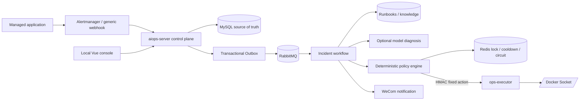

# Autonomous Agent Architecture

## Runtime topology



## Trust boundary

`aiops-server` does not mount Docker Socket. It can express only the action enum in `ops-contract`. `ops-executor` independently maps a service ID to a configured container name, rejects unknown targets, validates clock skew and HMAC, blocks replayed nonces, and journals request IDs before calling Docker.

This double allowlist is deliberate. Compromising the model prompt or control-plane database cannot turn the executor into a general host command channel.

## Incident state machine

```text
RECEIVED
  -> COLLECTING_EVIDENCE
  -> DIAGNOSING
  -> PLANNED
  -> POLICY_CHECKING
  -> EXECUTING
  -> VERIFYING
  -> RESOLVED
```

Failure branches are `RETRY_SCHEDULED`, `ROLLING_BACK`, `MANUAL_REQUIRED`, `FAILED`, and `SUPPRESSED`. Terminal states cannot restart automatically. MySQL optimistic locking prevents silent concurrent state overwrites.

## Delivery and idempotency

- Incident ingestion uses `(source, event_key)` as the external idempotency key.
- MySQL commits the incident and Outbox record in one transaction.
- RabbitMQ is at-least-once; consumers therefore assume duplicates.
- Redis provides a per-service lease so two incidents cannot write the same service concurrently.
- Every remediation uses a stable idempotency key based on incident, action, and retry number.
- The executor stores `STARTED` before Docker mutation and the serialized result afterward.
- A crash with an unknown action outcome is escalated instead of blindly repeating the mutation.

## AI responsibility

The model receives the incident, executor evidence, and a matched approved Runbook. It returns structured diagnosis fields only. It cannot call Docker and it cannot bypass policy. If parsing, API access, or knowledge matching fails, the system uses an approved Runbook fallback or requests manual intervention.

## Production extensions

The current boundary is single-host Docker. A future Kubernetes executor should be a separate implementation of the same action contract, with namespace and resource allowlists, dry-run support, rollout status verification, and Kubernetes-native rollback. It should not be added by exposing `kubectl` shell execution.
